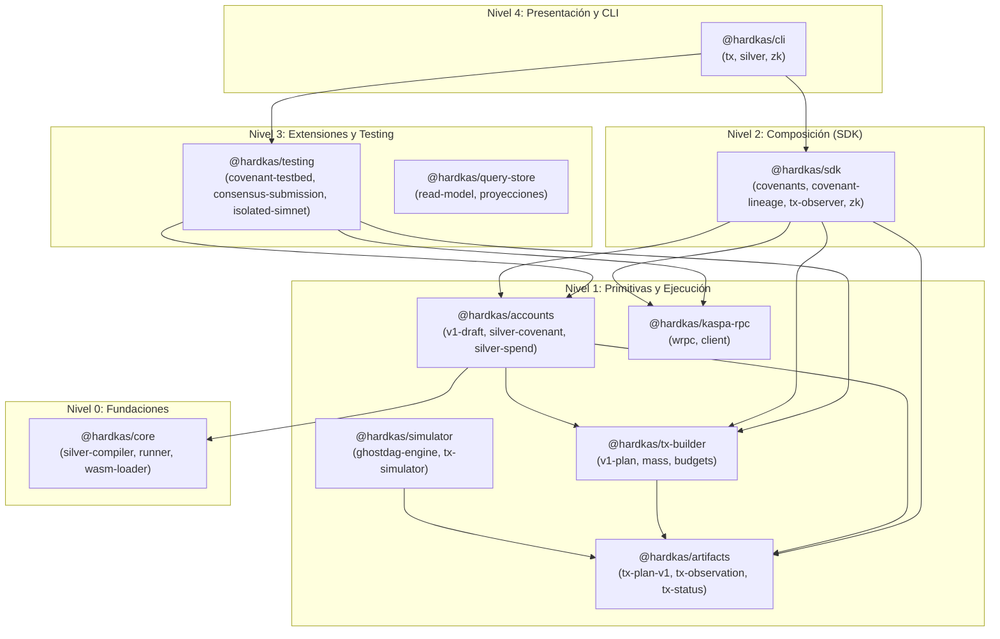
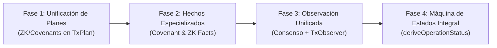

# HARDKAS — AUDITORÍA DE MADUREZ ARQUITECTÓNICA: CICLO DE VIDA AVANZADO (TX + COVENANTS + ZK)

**Fecha:** 4 de Noviembre de 2026  
**Commit Auditado:** `9970e260d7a9e217aa711e61d0018ad283e6e26f` (`origin/main`)  
**Versión del Framework:** `0.13.0-rc.1`  
**Autor:** Auditoría de Arquitectura de Sistemas y Seguridad Kaspa L1  

---

## 1. RESUMEN EJECUTIVO

HardKAS ha implementado con notable madurez el paradigma **«persistir hechos inmutables, derivar estados deterministas»** para transacciones estándar L1 y transiciones v1. La arquitectura se basa en separar de manera tajante la captura de observaciones de red (`TxObservationArtifact`, `TxSubmissionArtifact`) de la función pura de derivación de estado (`deriveTxStatus`), erradicando dependencias temporales y efectos colaterales.

Sin embargo, al auditar cómo este modelo se extiende a **Covenants (SilverScript)** y **Zero-Knowledge (Toccata KIP-16 OpZkPrecompile)** en la rama `origin/main`, se observa una marcada asimetría arquitectónica:

1. **Transacciones L1 (Base):** **MADURA Y COMPLETA.** Dispone de planificación formal (`TxPlanArtifact`), borradores multilaterales desacoplados (`V1TxDraft`), observación pura de cinco lecturas (`TxObserver`) y máquina de estados funcional pura (`deriveTxStatus`) con 12 estados deterministas tolerantes a reorganizaciones del DAG.
2. **Covenants (SilverScript v1.0.0):** **PARCIALMENTE CONECTADA.** El pipeline de construcción y gasto de covenants (`buildCovenantGenesis`, `buildCovenantTransitionDraft`) ya produce planes v1 y borradores (`V1TxDraft`) compatibles con la tubería de transacciones, e implementa reconstrucción histórica de linaje (`reconstructCovenantLineage`). No obstante, la observación en ejecución y preflight de consenso (`ConsensusSubmissionEvidence` en `@hardkas/testing`) discurre por canales paralelos sin unificar sus hechos en el esquema canónico de `TxObservationArtifact`.
3. **Zero-Knowledge (Toccata Groth16):** **AISLADA Y EN ESTADO EMBRIONARIO.** En `origin/main`, el módulo ZK (`@hardkas/sdk/zk`) opera como un subsistema aislado. Genera transacciones WASM directas (`buildR0Groth16Transaction`) puenteando por completo el `TxPlanService`, `V1TxDraft` y `TxObserver`. Sus scripts son estrictamente `proof-only` (carecen de introspección de outputs en L1) y su evidencia (`ZkExecutionEvidence`) es un artefacto ad-hoc de pruebas que no alimenta la máquina de estados.
4. **Simulador (@hardkas/simulator):** **APROXIMATIVO Y ESTRUCTURAL.** Es un motor experimental de topología GHOSTDAG y cálculo de masa (`ApproxGhostdagEngine`, `TxSimulator`). No ejecuta contratos ni evalúa ScriptVM; la validación de consenso real recae en `@hardkas/testing/isolated-simnet` sobre contenedores `rusty-kaspad v2.1.0`.

El presente informe desglosa el inventario técnico, la matriz de integración, las evidencias de código y pruebas, y evalúa minuciosamente las 9 preguntas sobre la viabilidad de reconstruir el ciclo de vida completo de operaciones complejas.

---

## 2. MAPA ARQUITECTÓNICO ACTUAL

La arquitectura de HardKAS en `origin/main` se estructura formalmente en cinco niveles de dependencia (Nivel 0 a Nivel 4):



### 2.1. Pipeline de Transacciones L1 (Base Estabilizada)

El ciclo de vida de una transacción estándar en HardKAS responde a un diseño estrictamente determinista:

1. **`TxPlan` / `TxPlanArtifact` (`@hardkas/tx-builder`, `@hardkas/artifacts`):**
   - Archivos: `packages/tx-builder/src/v1-plan.ts`, `packages/artifacts/src/tx-plan-v1.ts`.
   - Propósito: Congela la intención transaccional en un artefacto inmutable (`hardkas.txPlan.v1`). Modela inputs, outputs, mass de almacenamiento (`v1StorageMass`), presupuestos computacionales (`estimateV1ComputeBudget`), fees y linaje de outpoints.
2. **`V1TxDraft` (`@hardkas/accounts`):**
   - Archivo: `packages/accounts/src/v1-draft.ts`.
   - Propósito: Representa el borrador multilateral (`hardkas.v1TxDraft`). Implementa slots de firma independientes (`signDraft`), verificación previa (`checkDraft`), combinación (`combineDrafts`) y finalización (`finalizeDraft`). Desacopla la autorización del transporte.
3. **`TxObserver` (`@hardkas/sdk`, `@hardkas/artifacts`):**
   - Archivo: `packages/sdk/src/tx-observer.ts`.
   - Propósito: Realiza una única observación puntual e inmutable consultando 5 endpoints RPC del nodo (`getMempoolEntryByTransactionId`, `getUtxosByAddresses`, `getBlockDagInfo`, `getVirtualChainFromBlock`, etc.). Emite un artefacto inmutable `hardkas.txObservation.v1`. No almacena estado en memoria; solo persiste el hecho observado.
4. **`deriveTxStatus` (`@hardkas/artifacts`):**
   - Archivo: `packages/artifacts/src/tx-status.ts`.
   - Propósito: Función matemática pura `(submission, observations[]) => TxStatusResult`. Evalúa los hechos registrados y deriva uno de los 12 estados formales del ciclo de vida:
     - `SUBMITTED`, `REJECTED_BY_NODE`, `MEMPOOL_ACCEPTED`, `MEMPOOL_ORPHAN`, `ACCEPTED`, `CONFIRMED`, `FINALIZED`, `REORGED`, `UNOBSERVABLE_PRUNED`, `INSUFFICIENT_EVIDENCE`, `CONFLICTING_OBSERVATIONS`, `SYNTHETIC_EXECUTED`.

### 2.2. Pipeline de Covenants y SilverScript

El flujo de covenants Toccata v1 se apoya en SilverScript v1.0.0:

1. **Compilación y Metadatos:**
   - Archivo: `packages/core/src/silver-compiler.ts`.
   - Genera el artefacto ABI `SilAbiArtifact` con firmas canónicas de funciones, variables de estado y parámetros.
2. **Despliegue y Gasto:**
   - Archivos: `packages/accounts/src/silver-covenant.ts`, `packages/accounts/src/silver-spend.ts`.
   - `buildCovenantGenesis`: Crea el UTXO inicial (Génesis) vinculando el estado inicial mediante `silverP2shLock` y generando una transacción version 1 con script P2SH.
   - `buildCovenantTransitionDraft`: Construye el borrador de transición (`V1TxDraft`) vinculando inputs, estado sucesor (`declaredState`), inputs de autorización y delegados.
3. **Reconstrucción de Linaje Histórico:**
   - Archivo: `packages/sdk/src/covenant-lineage.ts`.
   - Funciones: `reconstructCovenantLineage()`, `collectCovenantTransactions()`.
   - Rastrea la cadena completa de transiciones de un covenant a partir de los artefactos del workspace: identifica el ancla génesis, vincula transacciones de gasto por outpoint, extrae estados anteriores y sucesores, y marca estados no confirmados o rechazados.
4. **Banco de Pruebas y Preflight (`@hardkas/testing`):**
   - Archivo: `packages/testing/src/covenant-testbed.ts`.
   - Soporta tres niveles de preflight:
     - `STRUCTURAL_PREFLIGHT`: Análisis estático fuera de cadena de la transición (AST, cálculo de mass, compatibilidad de tipos).
     - `SCRIPT_VM_PREFLIGHT`: Ejecución del escenario en el runner externo oficial de SilverScript con políticas de confianza (`runnerTrust`: `require-verified` vs `allow-unverified`).
     - `CONSENSUS_SIMNET_PREFLIGHT`: Envío real al nodo simnet Dockerizado, minado de bloques y confirmación mediante inspección del índice UTXO virtual.

### 2.3. Pipeline ZK (Toccata Groth16 BN254)

El módulo ZK en `origin/main` comprende:

1. **Construcción de Scripts y Transacciones:**
   - Archivo: `packages/sdk/src/zk/toccata.ts`.
   - Clase: `ZkScriptBuilder`. Genera el script de desbloqueo y el script de redención P2SH invocando `OpZkPrecompile` (`0xa6`) con la etiqueta `0x20` (Groth16 BN254).
   - Función: `buildR0Groth16Transaction()`. Construye directamente una instancia de `kaspa.Transaction` de WASM.
2. **Verificación Matemática Off-chain:**
   - Archivo: `packages/sdk/src/zk/groth16-verifier.ts`.
   - Función: `verifyGroth16Proof()`. Utiliza `@noble/curves/bn254` para validar el emparejamiento bilineal de la prueba Groth16 antes de someterla al nodo.
3. **Evidencia y Ejecución Simnet:**
   - Archivo: `packages/sdk/test/zk-toccata-l1.simnet.test.ts`.
   - Esquema: `hardkas.zk.executionEvidence.v1` (`ZkExecutionEvidenceSchema` en `@hardkas/artifacts`).
   - Registra el resultado del precompile contra un nodo `rusty-kaspad v2.1.0` real.

### 2.4. Simulador (@hardkas/simulator)

- Archivos: `packages/simulator/src/ghostdag-engine.ts`, `packages/simulator/src/tx-simulator.ts`.
- Naturaleza: Motor experimental aproximado. Modela la estructura del grafo GHOSTDAG (k-cluster, mergeset, selected parent, blue work/score) y profiling de mass.
- Relación con contratos: **No ejecuta ScriptVM**. La nota en `packages/simulator/src/index.ts:88` explicita: *«SilverScript contract execution is not simulated here: hardkas silver test runs contracts on the official SilverScript runner (@hardkas/core)»*.

---

## 3. MATRIZ DE INTEGRACIÓN

A continuación se clasifica cada capacidad clave del framework en función de su nivel de integración con el pipeline unificado de hechos y estados de HardKAS:

- **INTEGRATED:** Conectada plenamente a la tubería común de artefactos, persistencia inmutable y derivación de estados.
- **PARTIAL:** Funcionalidad implementada, pero carece de unificación en esquemas o desacoplada de la máquina de estados.
- **ISOLATED:** Implementada de manera autónoma, puenteando el pipeline principal.
- **MISSING:** Capacidad no implementada en el código.
- **NOT VERIFIED:** Implementada pero sin respaldo de pruebas verificables en `main`.

| Capacidad | Clasificación | Archivo Principal | Función / Clase Clave | Suite de Pruebas Asociada |
|---|---|---|---|---|
| **Planificación Transaccional V1** | `INTEGRATED` | `packages/tx-builder/src/v1-plan.ts` | `createV1Plan()` | `packages/tx-builder/test/plan.v1.test.ts` |
| **Borrador Multilateral de Firma** | `INTEGRATED` | `packages/accounts/src/v1-draft.ts` | `V1TxDraft`, `signDraft()`, `checkDraft()` | `packages/accounts/test/v1-draft.test.ts` |
| **Observación Pura de Red (5 reads)** | `INTEGRATED` | `packages/sdk/src/tx-observer.ts` | `TxObserver.observe()`, `observeTxOnce()` | `packages/sdk/test/observer.unit.test.ts` |
| **Derivación Pura de Estados Tx** | `INTEGRATED` | `packages/artifacts/src/tx-status.ts` | `deriveTxStatus()` (12 estados) | `packages/artifacts/test/node-rejection.test.ts` |
| **Génesis de Covenants (SilverScript)** | `INTEGRATED` | `packages/accounts/src/silver-covenant.ts` | `buildCovenantGenesis()` | `packages/accounts/test/silver-covenant.silverc.test.ts` |
| **Borrador de Transición de Covenants** | `INTEGRATED` | `packages/accounts/src/silver-spend.ts` | `buildCovenantTransitionDraft()` | `packages/accounts/test/silver-spend.silverc.test.ts` |
| **Reconstrucción de Linaje Covenant** | `PARTIAL` | `packages/sdk/src/covenant-lineage.ts` | `reconstructCovenantLineage()` | `packages/artifacts/test/lineage.test.ts` |
| **Preflight Estructural Covenants** | `INTEGRATED` | `packages/testing/src/covenant-testbed.ts` | `CovenantTestbed.executeTransition()` | `packages/cli/test/silver-dev-json-numbers.silver-runner.test.ts` |
| **Preflight ScriptVM Covenants** | `PARTIAL` | `packages/core/src/silver-runner.ts` | `executeSilverVmScenario()` | `packages/cli/test/silver-runner-outcome.silverc.test.ts` |
| **Consenso Simnet Covenants** | `PARTIAL` | `packages/testing/src/consensus-submission.ts` | `submitAndObserveConsensus()` | `packages/testing/test/isolated-simnet.test.ts` |
| **Extracción y Parseo de Pruebas ZK** | `INTEGRATED` | `packages/sdk/src/zk/risc0-parser.ts` | `parseR0Receipt()`, `splitGroth16Receipt()` | `packages/sdk/test/zk-security-phase1.test.ts` |
| **Verificación Matemática Off-chain ZK**| `INTEGRATED` | `packages/sdk/src/zk/groth16-verifier.ts`| `verifyGroth16Proof()` | `packages/sdk/test/zk-crypto-phase2.test.ts` |
| **Generador de Scripts ZK Toccata** | `PARTIAL` | `packages/sdk/src/zk/toccata.ts` | `ZkScriptBuilder.newR0()` | `packages/sdk/test/zk-security-phase1.test.ts` |
| **Transacción ZK integrada en TxPlan** | `ISOLATED` | `packages/sdk/src/zk/toccata.ts` | `buildR0Groth16Transaction()` | `packages/sdk/test/zk-toccata-l1.simnet.test.ts` |
| **Consenso L1 OpZkPrecompile** | `INTEGRATED` | `packages/sdk/test/zk-toccata-l1.simnet.test.ts` | Precompile `0xa6` en `rusty-kaspad` | `packages/sdk/test/zk-toccata-l1.simnet.test.ts` |
| **Introspección Outputs en Script ZK** | `MISSING` | `packages/sdk/src/zk/toccata.ts` | Script termina en `0xa6` (*proof-only*) | Sin implementación en `origin/main` |
| **Máquina de Estados ZK/Covenant** | `MISSING` | `packages/artifacts/src/tx-status.ts` | No existen estados de ciclo de vida ZK | N/A |
| **Simulador de Ejecución ScriptVM** | `MISSING` | `packages/simulator/src/index.ts` | Solo simula DAG y masa; no scripts | `packages/simulator/test/scenarios.test.ts` |

---

## 4. EVIDENCIA DE CÓDIGO Y PRUEBAS

### 4.1. El Pipeline L1: Determinismo Radical
En `packages/artifacts/src/tx-status.ts:31-72`, la función `deriveTxStatus` opera como una función pura que no ejecuta I/O:
```typescript
export function deriveTxStatus(
  submission: TxSubmissionArtifact,
  observations: readonly TxObservationArtifact[]
): TxStatusResult
```
La lógica procesa observaciones ordenadas cronológicamente. Si el nodo devuelve un rechazo formal (`observation.result === "REJECTED_BY_NODE"`), la función deriva `REJECTED_BY_NODE`. Si la transacción desaparece de la cadena seleccionada tras haber sido aceptada y no es visible en el índice UTXO, deriva `REORGED`. Todo el modelo descansa en observaciones persistidas como JSON firmados o identificados por hash de contenido (`contentHash`).

### 4.2. Covenants: Integración en Borrador pero Desconexión en Observación
En `packages/accounts/src/silver-spend.ts:184-245`, la función `buildCovenantTransitionDraft` genera un borrador formal:
```typescript
return createV1TxDraftArtifact({
  plan: planArtifact,
  signers,
  declaredState: params.nextState
});
```
Esto demuestra que el covenant genera un `TxPlanArtifact` y un `V1TxDraft` genuinos. Asimismo, `packages/sdk/src/covenant-lineage.ts:167-270` es capaz de reconstruir la cadena causal:
```typescript
export function reconstructCovenantLineage(
  transactions: readonly CovenantLineageTransaction[],
  covenantId: string
): CovenantLineageReport
```
Sin embargo, cuando la transacción se somete a consenso en `@hardkas/testing/src/covenant-testbed.ts`, no se utiliza `TxObserver` para capturar la evolución de la red, sino `submitAndObserveConsensus()` (`consensus-submission.ts:120-210`), la cual almacena un objeto ad-hoc `ConsensusSubmissionEvidence` que registra etapas (`BUILT`, `SENT`, `RPC_ACCEPTED`, `NODE_ACCEPTED`, `DAG_CONFIRMED`). Esta evidencia de consenso **no se serializa en el ledger de artefactos de `@hardkas/artifacts`** ni se evalúa a través de `deriveTxStatus`.

### 4.3. ZK: Transacciones Crudas y Vulnerabilidad de Composición (*Proof-Only*)
En `packages/sdk/src/zk/toccata.ts:251-289`, `buildR0Groth16Transaction` instancia directamente la clase de bajo nivel de WASM:
```typescript
return new kaspa.Transaction({
  version: 1,
  inputs: [ ... ],
  outputs: params.outputs.map(o => new kaspa.TransactionOutput(o.amount, o.scriptPublicKey)),
  ...
});
```
No genera un `TxPlanArtifact`, no interactúa con `TxPlanService`, y no emite un `V1TxDraft`.

Más grave aún: el script de redención generado en `toccata.ts:153-172`:
```typescript
// packages/sdk/src/zk/toccata.ts:164
builder.pushData(Buffer.from(params.imageId, "hex"));
builder.pushData(Buffer.from(params.journalHash, "hex"));
builder.pushOp(OpCodes.OpZkPrecompile); // 0xa6
return builder.build();
```
El script finaliza en el opcode `OpZkPrecompile` (`0xa6`). No contiene opcodes de introspección (`OpTxOutputSpk`, `OpTxOutputAmount`, etc.). Por consiguiente, a nivel de consenso L1, **cualquier actor que posea la prueba Groth16 puede gastar el UTXO hacia cualquier dirección de destino y con cualquier importe**, invalidando cualquier restricción off-chain declarada fuera del script.

---

## 5. DISTANCIA A LA ARQUITECTURA OBJETIVO

Evaluación minuciosa de las 9 preguntas formuladas para comprobar si es viable reconstruir el ciclo de vida completo de operaciones complejas con la arquitectura actual de HardKAS:

### Pregunta 1: ¿Quién originó la operación?
* **Transacciones L1:** `YA POSIBLE`. `TxPlanArtifact` registra explícitamente el campo `from` (`address`, tipo de autorizador) y la metadata de autoría del plan.
* **Covenants:** `PARCIAL`. `V1TxDraft` almacena la lista de firmantes (`signers: [{ address, role }]`) e inputs autorizadores. Si la transacción se construye vía `TxPlanService`, el originador queda persistido; si se ejecuta a través de herramientas de bajo nivel o testbed rápido, la intención de autoría solo reside en la llamada efímera.
* **ZK:** `NO POSIBLE`. `buildR0Groth16Transaction` toma outputs arbitrarios y outpoints crudos; no implementa esquema de procedencia, ni artefacto de intención ni autoría identificable.

### Pregunta 2: ¿Qué covenant o programa ZK intervino?
* **Covenants:** `YA POSIBLE`. `covenant-lineage.ts` y `SilAbiArtifact` registran `covenantId`, `contractName`, `artifactSha256` y el nombre de la función invocada (`entrypoint`). La correlación entre la transacción y el código SilverScript es total.
* **ZK:** `PARCIAL`. En `origin/main`, el `ZkExecutionEvidence` (artefacto de prueba) registra `imageId`, `journalHash` y etiqueta `0x20`. Sin embargo, en el runtime productivo de `@hardkas/sdk`, la transacción resultante no conserva ningún metadato persistente que enlace el hash de la transacción con el circuito o programa origen, obligando a inspeccionar el bytecode en bruto del script de desbloqueo.

### Pregunta 3: ¿En qué estado estaba el UTXO antes de la operación?
* **Covenants:** `YA POSIBLE`. `reconstructCovenantLineage()` resuelve los outpoints consumidos contra las transacciones padre registradas en los artefactos del workspace, decodificando las variables de estado previas (`previousStates`).
* **ZK:** `NO POSIBLE`. En `origin/main`, los scripts ZK son `proof-only` y carecen de estado interno. El UTXO es un simple depósito P2SH sin campos de estado ni memoria previa.

### Pregunta 4: ¿Qué condiciones se pretendían cumplir?
* **Covenants:** `PARCIAL`. El ABI del contrato y el campo `declaredState` en el borrador (`V1TxDraft`) definen el estado pretendido. Sin embargo, precondiciones temporales (DAA score, locktime relativo) o invariantes de negocio no se capturan en un artefacto formal de aserción fuera del entorno de `covenant-testbed`.
* **ZK:** `NO POSIBLE`. En `origin/main`, la única condición exigida en consenso es que la prueba Groth16 sea matemáticamente válida para `(imageId, journalHash)`. Las condiciones de pago (beneficiario, importe, comisión máxima) no forman parte del script ni quedan plasmadas en una especificación de intenciones vinculante.

### Pregunta 5: ¿Qué validaciones se ejecutaron y con qué resultado?
* **Covenants:** `PARCIAL`. `CovenantTestbed` evalúa validación estructural (`STRUCTURAL_PREFLIGHT`) y ejecución en máquina virtual (`SCRIPT_VM_PREFLIGHT`), capturando diagnósticos de error (`SilverVmFailureDiagnostic`) y presupuesto de cómputo. No obstante, estas evidencias se descartan en memoria durante el uso habitual del SDK y no se archivan en el almacén de evidencias del workspace (`.hardkas/evidence`).
* **ZK:** `PARCIAL`. `verifyGroth16Proof()` ejecuta la verificación matemática off-chain mediante `@noble/curves/bn254` y `OpZkPrecompile` valida en el nodo. Sin embargo, no existe un artefacto que certifique qué comprobaciones de curva se superaron, qué compute budget consumió la verificación ni bajo qué parámetros exactos.

### Pregunta 6: ¿Qué transacción consumió el UTXO?
* **Transacciones L1 y Covenants:** `YA POSIBLE`. A través de `collectCovenantTransactions()` y el resolvedor de outpoints del pipeline común, es posible rastrear el `transactionId` que consumió un UTXO determinado examinando los inputs de las transacciones registradas.
* **ZK:** `PARCIAL`. La transacción que consume el UTXO posee un identificador único en Kaspa, pero al no existir un índice o registro de linaje ZK, correlacionar qué transacción gastó un outpoint P2SH ZK requiere consultar activamente el nodo RPC si no se anotó manualmente en el cliente.

### Pregunta 7: ¿En qué estado quedó el UTXO sucesor?
* **Covenants:** `YA POSIBLE`. `CovenantLineageOutput.declaredState` registra con exactitud las variables de estado sucesoras generadas en los outputs de la transacción.
* **ZK:** `NO POSIBLE`. En `origin/main`, la transacción ZK es puramente terminal (liquida el saldo hacia un payout P2PK ordinario). No contempla continuación de estado ni UTXOs sucesores encadenados.

### Pregunta 8: ¿Qué ocurre si la transacción se rechaza, entra en conflicto o es afectada por una reorganización?
* **Transacciones L1:** `YA POSIBLE`. La función pura `deriveTxStatus` gestiona con exactitud estos escenarios, clasificando el estado en `REJECTED_BY_NODE`, `CONFLICTING_OBSERVATIONS` o `REORGED` ante desviaciones del blue score o cambios en la cadena seleccionada.
* **Covenants:** `PARCIAL`. La transacción base recibe el estado derivado correspondiente, pero las consecuencias específicas sobre el covenant (por ejemplo, reversión del estado proyectado, invalidación de transiciones hijas en memoria, o reactivación del UTXO previo) no están modeladas como una máquina de estados de contrato; `covenant-lineage.ts` simplemente marca las transiciones no aceptadas como `REJECTED` o `UNCONFIRMED`.
* **ZK:** `NO POSIBLE`. Las transacciones ZK no pasan por `TxObserver`. Los fallos se limitan a excepciones crudas devueltas por la llamada RPC (`client.submitTransaction()`) capturadas en bloques `try/catch`.

### Pregunta 9: ¿Podemos reconstruir todo esto a partir de evidencias persistentes sin consultar el nodo en tiempo real?
* **Transacciones L1:** `YA POSIBLE`. El grafo compuesto por `TxPlanArtifact` $\to$ `V1TxDraft` $\to$ `TxSubmissionArtifact` $\to$ `TxObservationArtifact[]` permite a cualquier auditor externo o nodo fuera de línea reconstruir con precisión matemática el estado de la transacción invocando `deriveTxStatus()`.
* **Covenants:** `PARCIAL`. Es posible reconstruir la topología y los estados intermedios mediante `reconstructCovenantLineage()`, pero faltan los artefactos de observación estandarizados específicos de covenant para prescindir totalmente de consultas activas al nodo en transiciones dudosas.
* **ZK:** `NO POSIBLE`. En `origin/main`, sin conexión en tiempo real al nodo, es imposible conocer el destino o el éxito de una operación ZK porque no se almacena ningún conjunto coherente de artefactos de intención, envío u observación fuera de los ficheros de log de los tests unitarios.

---

## 6. PUNTOS CIEGOS (BLIND SPOTS) IDENTIFICADOS

1. **La brecha de seguridad *Proof-Only* en ZK (`origin/main`):**
   El hallazgo más crítico de la arquitectura ZK actual es la desconexión entre la prueba matemática y los fondos transferidos. En `origin/main`, la transacción no incluye introspección de transacción en el script. Si un atacante intercepta la prueba Groth16 en la mempool, puede reconstruir la transacción hacia su propia dirección y minarla legítimamente.
2. **Puenteo del Pipeline de Transacciones por parte de ZK:**
   El módulo ZK fue concebido como un prototipo criptográfico y no como un ciudadano de primera clase del transactional pipeline. No utiliza `TxPlan`, no usa `V1TxDraft`, no emite `TxSubmissionArtifact` y no implementa `TxObserver`.
3. **Dualidad de Observadores (Testing vs SDK):**
   `@hardkas/testing` implementa `submitAndObserveConsensus()` con su propio modelo de fases (`BUILT`, `SENT`, `RPC_ACCEPTED`, `NODE_ACCEPTED`, `DAG_CONFIRMED`), ignorando completamente a `TxObserver` y a `deriveTxStatus` de `@hardkas/artifacts`. Existen dos implementaciones distintas para observar transacciones en el monorepo.
4. **Falta de Reversibilidad de Estado en Proyecciones Covenant ante Reorgs:**
   Aunque `deriveTxStatus` detecta el estado `REORGED` para una transacción, `covenant-lineage.ts` no dispone de ganchos (*hooks*) de compensación para rebobinar el estado del contrato cuando un bloque aceptado queda descanonizado en el DAG.
5. **Aislamiento del Simulador:**
   `@hardkas/simulator` permanece confinado al análisis teórico de GHOSTDAG y cálculo de mass. No está conectado ni a la ejecución de SilverScript ni a la verificación de ZK, creando una falsa sensación de entorno de simulación completo cuando en realidad todo el testing funcional depende de Docker y `rusty-kaspad`.

---

## 7. PLAN DE EVOLUCIÓN MÍNIMA POR FASES

Para extender el modelo **«persistir hechos, derivar estados»** a Covenants y ZK sin incurrir en reescrituras disruptivas, se plantea una hoja de ruta en cuatro fases incrementales:



### Fase 1: Unificación del Modelo de Intención (`TxPlan` y `V1TxDraft`)
* **Objetivo:** Erradicar la creación directa de transacciones WASM en ZK y unificar el inicio del ciclo de vida.
* **Acciones:**
  1. Modificar `packages/sdk/src/zk/toccata.ts` para que `buildR0Groth16Transaction` utilice `createV1Plan()` de `@hardkas/tx-builder`.
  2. Introducir extensiones tipadas en `TxPlanArtifact`: campo opcional `covenantContext` y `zkContext` para almacenar hashes de circuito, IDs de imagen y compromisos públicos.
* **Riesgo:** Bajo. Refactorización interna de `@hardkas/sdk/zk`.
* **Esfuerzo:** 2-3 días.

### Fase 2: Introducción de Hechos Especializados en `@hardkas/artifacts`
* **Objetivo:** Formalizar los eventos criptográficos y de contrato como hechos inmutables.
* **Acciones:**
  1. Crear los esquemas de artefacto:
     - `hardkas.covenantTransitionFact.v1`: Registra la transición `(covenantId, previousOutpoint, declaredState, successorOutpoint)`.
     - `hardkas.zkVerificationFact.v1`: Registra la verificación matemática off-chain `(curve, proofSha256, publicInputs, verificationResult)`.
  2. Persistir estos hechos automáticamente en el ledger de artefactos durante las operaciones del SDK.
* **Riesgo:** Mínimo. Adición de esquemas sin romper los existentes.
* **Esfuerzo:** 3 días.

### Fase 3: Unificación de la Observación de Red y Eliminación de Código Redundante
* **Objetivo:** Converger la observación de `@hardkas/testing` con `TxObserver`.
* **Acciones:**
  1. Refactorizar `packages/testing/src/consensus-submission.ts` para que consuma directamente `TxObserver.observe()` en cada iteración de sondeo.
  2. Emitir artefactos estándar `hardkas.txObservation.v1` tanto en simnet de pruebas como en redes activas.
  3. Vincular `covenant-lineage.ts` al flujo de eventos de `TxObserver`.
* **Riesgo:** Medio. Requiere ajustar aserciones en los tests de `@hardkas/testing`.
* **Esfuerzo:** 4-5 días.

### Fase 4: Extensión de la Máquina de Estados Pura (`deriveOperationStatus`)
* **Objetivo:** Derivar el estado integral de la operación (no solo de la transacción de transporte).
* **Acciones:**
  1. Crear la función pura `deriveCovenantStatus(transitionFact, txStatus)` y `deriveZkOperationStatus(zkFact, txStatus)`.
  2. Incorporar estados avanzados: `TRANSITION_CONFIRMED`, `COVENANT_STATE_ROLLED_BACK`, `PROOF_VERIFIED_TX_REJECTED`, `ZK_SETTLED`.
  3. Proporcionar resolución determinista de reorganizaciones de DAG sobre estados proyectados de covenants.
* **Riesgo:** Medio-Bajo. Puramente algorítmico y libre de I/O.
* **Esfuerzo:** 3-4 días.

---

## 8. VEREDICTO DE MADUREZ CON CRITERIOS EXPLÍCITOS

El estado de madurez de HardKAS `origin/main` frente al paradigma arquitectónico se dictamina bajo cinco criterios de evaluación objetivos:

| Criterio | Estado Actual en `main` | Cumplimiento | Veredicto |
|---|---|:---:|:---:|
| **1. Separación Estricta Hechos / Derivación** | Implementada con rigor en transacciones L1 (`TxObservation` $\to$ `deriveTxStatus`). En Covenants y ZK la derivación está mezclada con efectos secundarios en testing o ausente. | 60% | **PARCIAL** |
| **2. Trazabilidad Causal Completa (Linaje)** | Covenants posee reconstrucción retrospectiva de linaje (`reconstructCovenantLineage`). ZK carece totalmente de modelo de linaje causal. | 50% | **PARCIAL** |
| **3. Inmutabilidad y Persistencia de Evidencias** | Transacciones y Covenants generan planes y borradores inmutables en disco. ZK genera transacciones efímeras en memoria sin artefactos de intención. | 40% | **INSUFICIENTE** |
| **4. Tolerancia y Reversibilidad ante Reorgs del DAG** | La máquina de estados L1 detecta `REORGED` con precisión. No existe propagación de rollback hacia los modelos de estado de Covenants ni a operaciones ZK. | 35% | **INSUFICIENTE** |
| **5. Unicidad de la Tubería de Ejecución** | Transacciones y Covenants comparten `TxPlan` y `V1TxDraft`. ZK opera por una vía totalmente paralela e inconexa (*proof-only bypass*). | 45% | **FRAGMENTADA** |

### Veredicto Global: **MADUREZ ARQUITECTÓNICA HETEROGÉNEA (Nivel 2/5)**

HardKAS cuenta con un **núcleo transaccional de vanguardia**: el diseño de `packages/artifacts` y `packages/tx-builder` es ejemplar y resuelve con elegancia los problemas de concurrencia y reorganizaciones del DAG en Kaspa L1. Covenants está a un 75% del objetivo, contando ya con borradores y linaje estructurado. 

Sin embargo, ZK permanece en un estadio preliminar y desconectado, funcionando como un script de prueba de concepto criptográfica más que como una extensión integrada del framework. La distancia para completar la visión unificada no requiere rediseñar el framework, sino **hacer converger a Covenants y ZK dentro del sólido pipeline transaccional ya existente en `main`**, siguiendo el plan de evolución por fases detallado en este informe.
