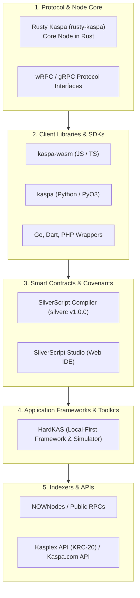

# Kaspa Developer Tools & Ecosystem: The Complete Technical Guide

Building decentralized software on Kaspa requires interacting with a high-throughput, parallel **Proof-of-Work BlockDAG**. Kaspa's protocol deviates substantially from traditional linear blockchains, offering sub-second block intervals, GHOSTDAG / KNIGHTHESIAN consensus, and a UTXO-based transactional model.

With the network-wide activation of the **Toccata upgrade on Kaspa mainnet on June 30, 2026 (at DAA score 474,165,565)** and the release of the **SilverScript compiler v1.0.0 on September 9, 2026**, the developer ecosystem has expanded significantly.

This directory provides an objective, technical overview of the primary developer tools, client libraries, infrastructure providers, and frameworks currently powering the Kaspa ecosystem.

---

## Ecosystem Architecture Overview

The Kaspa developer stack is organized into distinct functional layers:



---

## 1. Core Node Software & Protocol Clients

### Rusty Kaspa (`rusty-kaspa`)
- **Role:** Canonical full-node implementation of the Kaspa protocol.
- **Language:** Rust.
- **Key Features:** High-performance block processing, memory-efficient DAG storage, and native WebSocket RPC (`wRPC`) support.
- **Use Case:** Running a validator node, orchestrating private localnets, or conducting protocol-level research.
- **Repository:** [github.com/kaspanet/rusty-kaspa](https://github.com/kaspanet/rusty-kaspa)

### wRPC (WebSocket RPC)
- **Role:** The high-throughput communication protocol for querying nodes and submitting transactions.
- **Formats:** Borsh-serialized binary encoding for speed, or JSON for standard web integrations.
- **Documentation:** [docs.kaspa.org](https://docs.kaspa.org)

---

## 2. Official and Community SDKs

### `kaspa-wasm` (JavaScript / TypeScript)
- **Role:** Official WebAssembly-compiled SDK exposing core Rusty Kaspa primitives.
- **Ecosystem:** Browsers, Node.js, and web workers.
- **Key Features:** Client RPC communication, address generation, transaction construction, and payload serialization.
- **Best For:** Web wallets, dApp frontend integrations, and client-side signing.
- **Repository:** [github.com/kaspanet/rusty-kaspa/tree/master/wasm](https://github.com/kaspanet/rusty-kaspa/tree/master/wasm)

### `kaspa` (Python)
- **Role:** Python module with native Rust bindings via PyO3 and Maturin.
- **Key Features:** Pythonic RPC client, keypair management, and script construction utilities.
- **Best For:** Data science, blockchain analytics, machine learning bots, and backend scripting.

### Community Client Libraries
- **Go (`kaspa-go`):** Community-maintained bindings for Go-based microservices and high-concurrency daemons.
- **Dart / Flutter (`kaspa_dart`):** Mobile-optimized cryptographic libraries utilized primarily by mobile wallets (such as Kaspium).

---

## 3. Smart Contract & Covenant Languages

### SilverScript Compiler (`silverc`)
- **Role:** Official domain-specific language (DSL) and compiler for writing Kaspa covenants and UTXO spending scripts.
- **Current Version:** `v1.0.0` (Officially released September 9, 2026).
- **Architecture:** Compiles human-readable `.sil` scripts into structured Kaspa script bytecodes encumbering transaction outputs.
- **Consensus Relationship:** The compiler produces valid Kaspa script bytecodes conforming to Toccata consensus rules (active on mainnet since June 30, 2026, at DAA 474,165,565).
- **Use Case:** Defining escrows, timelocks, multisig conditions, and payment streaming vaults.

### SilverScript Studio
- **Role:** Browser-based visual development environment for SilverScript.
- **Key Features:** Online syntax highlighting, contract templates (multisig, timelocks), script compilation, and testnet deployment hooks.
- **Best For:** Rapid prototyping, educational learning, and visual contract inspection in the browser.

---

## 4. Application Frameworks & Local Toolkits

### HardKAS
- **Role:** Open-source, community-led developer framework and testing operating system for native Kaspa L1 development, maintained by KasLabDevs.
- **Language / Runtime:** TypeScript / Node.js 24.22.1 (exactly).
- **Key Features:**
  - **In-Memory Simulator:** Deterministic evaluation of transaction scripts and mass limits without network latency.
  - **Localnet Node Orchestration:** Single-command Docker lifecycle management for real `rusty-kaspa` nodes on simnet (`hardkas localnet start`).
  - **Reproducible Evidence Packages:** Generates cryptographically verifiable JSON receipts for every transaction step.
  - **CLI Diagnostic Suite:** Health checks and node comparison commands (`hardkas rpc health`, `hardkas doctor workspace`).
  - **Automated Test Runners:** Integration with Vitest for automated CI/CD transaction pipeline testing.
- **Best For:** Backend developers, wallet engineers, payment processor teams, and covenant protocol authors requiring reproducible local testing pipelines.
- **Repository:** [github.com/KasLabDevs/HardKas](https://github.com/KasLabDevs/HardKas)

---

## 5. Infrastructure Providers, Public RPCs & Indexers

### NOWNodes
- **Role:** Enterprise-grade blockchain infrastructure provider offering shared and dedicated Kaspa RPC node endpoints.
- **Use Case:** High-availability web applications that choose not to host self-managed full nodes.

### Kasplex API (KRC-20, Kasplex L1)
- **Role:** Specialized indexer and data API for the KRC-20 token standard and inscriptions on Kaspa.
- **Note:** Kasplex L1 (native assets / KRC-20) is distinct from the Kasplex L2 (EVM rollup) architecture.
- **Use Case:** Wallets, token analytics platforms, and marketplace backends tracking fungible tokens and NFTs.

---

## 6. Network Explorers & Diagnostics

| Tool | Focus | URL |
|---|---|---|
| **Kaspa Official Explorer** | Real-time blockDAG visualizer, address balances, transaction tracking | `explorer.kaspa.org` |
| **Katnip Explorer** | Extended analytics, KRC-20 tracking, DAG metrics | `katnip.kaspad.net` |
| **Kaspa Graph Inspector** | Academic and analytical visualization of DAG topology and blue scores | Community-hosted |

---

## How to Choose Your Kaspa Development Stack

Depending on the application you are building, consider the following recommended tool combinations:

```text
1. Web Wallet / Frontend dApp:
   → kaspa-wasm + Web3 Modal / Wallet Adapter + Public wRPC

2. Backend Service / Merchant Payment Processor:
   → HardKAS (Testing & Planning) + rusty-kaspa (Localnet node) + TypeScript

3. Smart Contracts & Covenants:
   → SilverScript (silverc) + HardKAS Simulator (Local verification)

4. Blockchain Analytics & Data Pipelines:
   → Python (kaspa) + Rusty Kaspa gRPC + Kasplex Indexer
```

---

## Important Technical Disclaimers

1. **Independent Ecosystem Directory:** This directory is compiled for educational purposes to reflect the Kaspa developer landscape. HardKAS is an independent community project and is not the official foundation or sole developer tool for Kaspa.
2. **Layer 1 vs. Layer 2:** Kaspa L1 does not execute Solidity or Ethereum EVM bytecode. If your application relies on EVM architecture, look into ecosystem Layer 2 projects (such as Igra or Kasplex L2; both are outside the HardKAS L1 core).
3. **Implemented Capabilities vs Experimental Modules:** In HardKAS, baseline 1:1 auth-bound covenant state transitions and transaction simulations are supported. Advanced modules like vProgs (programmability surface) and ZK are experimental research prototypes, not production infrastructure.

---

## Related Documentation & Official Resources

- [Kaspa L1 Development Framework](./kaspa-l1-development-framework.md)
- [Hardhat for Kaspa (EVM to Kaspa Guide)](../guides/hardhat-for-kaspa.md)
- [5-Minute Quickstart](../getting-started/quickstart.md)
- **Kaspa Official Documentation:** [docs.kaspa.org](https://docs.kaspa.org)
- **Kaspa Community Hub:** [kaspahub.org](https://kaspahub.org)
- **Kas-Smiths Builder Forum:** [kas-smiths.org](https://kas-smiths.org)
- **Kaspa Improvement Proposals:** [github.com/kaspanet/kips](https://github.com/kaspanet/kips)
