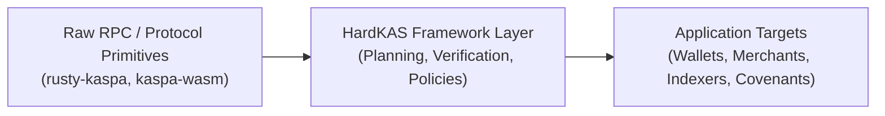
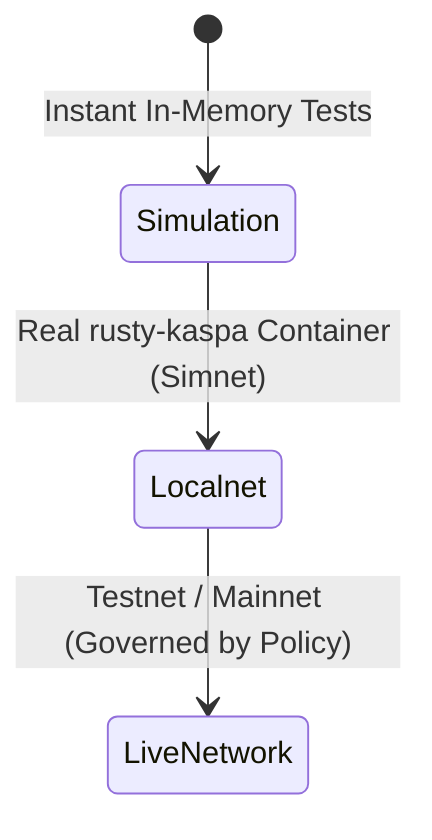

# Kaspa L1 Development Framework: Architecture & Engineering Guide

Building decentralized applications, payment infrastructure, and covenant logic natively on Kaspa Layer 1 requires a paradigm shift away from both traditional single-chain UTXO architectures (like Bitcoin) and global account-based virtual machines (like Ethereum). Kaspa operates on the **GHOSTDAG / KNIGHTHESIAN BlockDAG**, enabling high-throughput parallel blocks and rapid confirmation times while preserving Proof-of-Work security.

With the network-wide activation of the **Toccata upgrade on Kaspa mainnet on June 30, 2026 (at DAA score 474,165,565)** and the official release of the **SilverScript compiler v1.0.0 on September 9, 2026**, Kaspa L1 possesses native covenant capabilities.

However, developing on Kaspa L1 directly against raw RPC nodes introduces significant engineering friction:
- Developers must manually manage UTXO selection, change outputs, and mass calculation.
- Testing transaction scripts against live networks is slow, non-deterministic, and prone to state divergence.
- Transaction preparation, signing, and verification are often coupled into opaque routines that do not leave auditable records.

**HardKAS** is an open-source, community-led, local-first development framework for Kaspa L1 engineered by KasLabDevs. It provides the tooling, deterministic execution simulator, and reproducible artifact pipelines to develop and test Kaspa applications before they reach production. HardKAS itself does not claim mainnet production readiness.

---

## Why Kaspa L1 Needs a Development Framework

Direct RPC communication via `rusty-kaspa` or raw bindings through `kaspa-wasm` provide foundational protocol primitives, but they do not constitute an application framework. Building scalable backends, automated payment processors, or covenant workflows requires higher-level guarantees:

1. **State Isolation:** Developing against public testnets introduces unpredictable external UTXO consumption, network latency, and reorg uncertainty during local iteration.
2. **Deterministic Pre-flight Verification:** Before a transaction is broadcast to the network, developers need certainty that its signature scripts, covenant constraints, and mass limits are valid under protocol rules.
3. **Auditability and Lineage:** High-value transaction pipelines require every step (planning, fee calculation, input locking, signing, and broadcast) to generate immutable, verifiable records that can be replayed and inspected in CI/CD.



---

## Core Architecture: Local-First, UTXO-Native, Deterministic

HardKAS is designed around four foundational architectural principles:

### 1. Deterministic Simulation
HardKAS includes an in-memory Kaspa transaction simulator. The simulator evaluates transaction inputs, script execution, mass limits, and address formats without requiring network connections or disk I/O. It provides millisecond-level feedback loops during unit testing.

### 2. Execution Contracts & Evidence Packages
Every transactional operation in HardKAS is governed by an **Execution Contract**. When a transaction is planned, signed, or executed, the framework emits a structured JSON artifact containing:
- The exact inputs and outputs.
- Fee and mass computations.
- The target execution environment hash.
- Lineage links to previous operations.

These artifacts form an **Evidence Package** that allows any developer or automated pipeline to deterministically replay the exact state transition using:

```bash
hardkas replay verify --artifact .hardkas/artifacts/tx-example.json
```

### 3. Separation of Execution Worlds
HardKAS strictly segregates development into three distinct execution targets to prevent accidental contamination between environments:



- **Simulation (`simulated`):** Pure in-memory synthetic state. Perfect for unit tests and script edge-case verification.
- **Localnet (`localnet`):** An orchestrated local instance of a real `rusty-kaspa` node running inside Docker, mining real blocks on simnet. Validates consensus-level RPC interactions.
- **Live Networks (`testnet-10`, `testnet-11`, `mainnet`):** Public Kaspa networks. All mutations on live networks require explicit developer confirmation and are subject to policy engine guards.

---

## Developer Workflow: From Scaffold to Verification

A typical application workflow with HardKAS follows an explicit, verifiable progression:

### Step 1: Scaffold a New Workspace
Initialize a structured HardKAS project with configuration and TypeScript tooling:

```bash
npx hardkas init my-kaspa-app
cd my-kaspa-app
```

The workspace structure establishes separated directories for contracts, tests, scripts, and artifacts:
```text
my-kaspa-app/
├── hardkas.config.ts      # Environment, network, and policy definitions
├── contracts/             # SilverScript (.sil) contracts and covenants
├── scripts/               # Automation tasks and deployment pipelines
├── test/                  # Automated test suites (Vitest / HardKAS SDK)
└── .hardkas/artifacts/    # Immutable, versioned execution receipts
```

### Step 2: Plan a Transaction Deterministically
Generate an execution plan without touching private keys or broadcasting to the network:

```bash
hardkas tx plan --from kaspa:q... --to kaspa:p... --amount 500000000
```

This generates an auditable plan artifact in `.hardkas/artifacts/` detailing the exact UTXOs selected, fee deductions, and required signatures.

### Step 3: Verify and Inspect
Validate the plan against the local simulator to ensure script validity and mass limits:

```bash
hardkas tx verify --artifact .hardkas/artifacts/planned-tx.json
```

### Step 4: Run Automated Tests
Execute local unit and integration tests using standard test runners:

```bash
hardkas test
```

---

## Execution Guards and Safety Policies

In production systems, developer errors can lead to irreversible on-chain consequences (e.g., spending the wrong UTXO, broadcasting to mainnet during integration tests, or exhausting transaction mass).

HardKAS enforces **Execution Guards**:
- **Mainnet lockdown (`BLOCKED_BY_POLICY`):** Mainnet is locked down in this release: no connection (reads included, even to an endpoint you declare), no signing, no broadcast; no flag, option or configuration enables it (`MAINNET_CONNECTION_DISABLED`, `MAINNET_SIGNING_DISABLED`, `MAINNET_BROADCAST_DISABLED`).
- **DAG Mempool Awareness:** RPC UTXO adapters track mempool-spent inputs to prevent double-spend planning errors before submitting transactions.
- **Strict Network Matching:** Artifacts generated for `simulation` or `localnet` cannot be replayed or submitted to public networks without explicit migration.

---

## Technical Boundaries & Honest Limitations

To maintain architectural integrity, HardKAS explicitly establishes what it is and what it is not:

1. **Not a Consensus Node:** HardKAS orchestrates and interfaces with `rusty-kaspa`, but it does not implement Kaspa consensus rules itself. Final block validity is determined solely by consensus nodes on the network.
2. **Not an EVM Compatibility Layer:** Kaspa Layer 1 is a UTXO BlockDAG. HardKAS does not simulate Ethereum accounts, Solidity EVM bytecode, or Ethereum state trees on L1.
3. **Local Proofs vs. Consensus Acceptance:** Generating a valid HardKAS Evidence Package demonstrates that a transaction was correctly planned and signed according to protocol rules, but it does **not** constitute a cryptographic proof of inclusion or finality in the public BlockDAG until mined and confirmed by the network.
4. **Covenant Scope in HardKAS:** HardKAS implements baseline 1:1 auth-bound covenant state transitions, local inspection, and validation. It does not claim support for arbitrary unbounded multi-state covenants.
5. **Experimental Modules (vProgs & ZK):** Modules like vProgs (programmability surface) and ZK are experimental research prototypes. They are NOT production infrastructure and are excluded from default SDK entrypoints.

---

## Related Documentation & Official Sources

- [5-Minute Quickstart](../getting-started/quickstart.md)
- [Execution Contract Specification](./execution-contract.md)
- [Execution Environments & Worlds](./execution-environments.md)
- **Official Kaspa Node (Rusty Kaspa):** [github.com/kaspanet/rusty-kaspa](https://github.com/kaspanet/rusty-kaspa)
- **Kaspa Protocol Documentation:** [docs.kaspa.org](https://docs.kaspa.org)
- **HardKAS GitHub Repository:** [github.com/KasLabDevs/HardKas](https://github.com/KasLabDevs/HardKas)
- **Toccata Upgrade Specification (KIP-9):** [Kaspa Improvement Proposals](https://github.com/kaspanet/kips)
