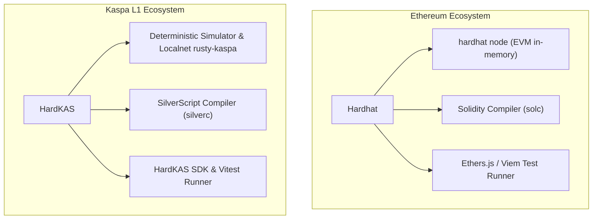

# Hardhat for Kaspa: A Developer's Guide to Building on Kaspa L1

If you come from the Ethereum or EVM ecosystem, you are likely familiar with **Hardhat**—the standard local development environment for compiling Solidity, running automated tests, managing local test nodes (`hardhat node`), and automating deployments.

When exploring the high-throughput, low-latency Kaspa ecosystem, developers often search for *"Hardhat for Kaspa"*. However, Kaspa Layer 1 is **not an EVM-based blockchain**; it is a high-speed Proof-of-Work BlockDAG operating on an unspent transaction output (**UTXO**) architecture with native covenants. The **Toccata upgrade activated on Kaspa mainnet on June 30, 2026 (at DAA score 474,165,565)**, introducing native covenants, followed by the official release of the **SilverScript compiler v1.0.0 on September 9, 2026**.

**HardKAS** is an open-source, local-first developer framework for Kaspa L1 designed to provide Ethereum developers with the ergonomic comfort, testing automation, and configuration-driven workflows they expect from Hardhat—while respecting the native architecture of Kaspa.

---

## The Paradigm Shift: EVM Account Model vs. Kaspa UTXO BlockDAG

To build effectively on Kaspa L1, developers must understand the fundamental architectural differences between Ethereum and Kaspa:

| Dimension | Ethereum / Hardhat | Kaspa L1 / HardKAS |
|---|---|---|
| **State Architecture** | Account-based with global mutable contract storage | Stateless UTXO graph; outputs consumed entirely and recreated |
| **Execution Topology** | Single sequential linear blockchain | Parallel BlockDAG (GHOSTDAG / KNIGHTHESIAN) |
| **Smart Contract Logic** | Solidity / Vyper executing in the EVM | SilverScript (`.sil`) compiling to native UTXO spending scripts / covenants |
| **State Mutation** | Modifying contract variables via gas transactions | Encumbering coin outputs with spending conditions |
| **Local Node Environment** | `hardhat node` (In-memory EVM simulation) | `hardkas localnet start` (Containerized real `rusty-kaspa` node on simnet) |
| **Fast In-Memory Testing** | Hardhat Network | HardKAS Deterministic Simulator |
| **Transaction Receipts** | Transaction hash with gas consumed | Evidence Package with lineage, mass calculation, and Merkle inputs |
| **Configuration File** | `hardhat.config.js` / `hardhat.config.ts` | `hardkas.config.ts` |

---

## Architectural Comparison: Hardhat vs. HardKAS

HardKAS mirrors the developer-friendly workflow of Hardhat, adapting every layer to Kaspa's UTXO and BlockDAG primitives:



### 1. Configuration: `hardkas.config.ts`
Just as Hardhat uses a central configuration file to define networks and compiler settings, HardKAS uses a typed `hardkas.config.ts`:

```typescript
import { defineConfig } from '@hardkas/config';

export default defineConfig({
  defaultNetwork: 'simulated',
  networks: {
    simulated: {
      type: 'simulated',
    },
    localnet: {
      type: 'localnet',
      rpcUrl: 'ws://127.0.0.1:17110',
    },
    testnet10: {
      type: 'rpc',
      rpcUrl: 'wss://testnet-10.kaspa.org/ws',
    },
  },
  policies: {
    blockMainnetBroadcast: true,
  },
});
```

### 2. Local Node & Fast Simulation
- In Hardhat, developers run `npx hardhat node` to spin up a local JSON-RPC server with pre-funded accounts.
- In HardKAS, developers have two options:
  1. **Instant In-Memory Simulator:** Used directly by test suites for microsecond script evaluation without starting any external process.
  2. **Managed Localnet:** Run a real, containerized `rusty-kaspa` node mining blocks locally on simnet:
     ```bash
     hardkas localnet start
     hardkas localnet status
     hardkas localnet stop
     ```

### 3. Automated Testing with the Real HardKAS SDK
Instead of deploying contracts to an EVM account and calling contract methods, Kaspa L1 tests verify that transaction inputs satisfy their encumbrances and that change outputs and fees balance accurately:

```typescript
import { describe, it, expect } from 'vitest';
import { Hardkas } from '@hardkas/sdk';

describe('Payment Transaction Pipeline', () => {
  it('should plan, sign, and simulate a 5 KAS payment', async () => {
    // 1. Initialize HardKAS SDK in deterministic simulator mode
    const sdk = await Hardkas.create({
      execution: { mode: 'simulator', domain: 'kaspa-l1', network: 'simulated' },
    });

    // 2. Plan a transaction
    const plan = await sdk.tx.plan({
      from: 'alice',
      to: 'bob',
      amount: '5',
    });

    expect(plan.summary.outputsCount).toBeGreaterThanOrEqual(1);

    // 3. Sign the transaction payload
    const signed = await sdk.tx.sign(plan, 'alice');
    expect(signed.signatures.length).toBeGreaterThanOrEqual(1);

    // 4. Simulate the execution
    const { receipt } = await sdk.tx.simulate(signed);
    expect(receipt.txId).toBeDefined();

    // 5. Verify deterministic replay
    const replayResult = await sdk.replay.verify();
    expect(replayResult.verified).toBe(true);
  });
});
```

---

## What About Kaspa Layer 2s and EVM Compatibility?

A common source of confusion in the ecosystem is whether Hardhat itself can be used on Kaspa:

1. **Kaspa Layer 1 (Base Layer):**
   - Native Kaspa L1 is a UTXO BlockDAG. It does **not** execute Solidity or EVM bytecode.
   - For L1 applications (native wallets, payment processors, covenants, SilverScript), you use **HardKAS**.
2. **Kaspa Layer 2 Networks (e.g., Igra, Kasplex L2):**
   - Several ecosystem projects develop EVM-compatible Layer 2s that use Kaspa L1 for sequencing and data availability. Proof-based settlement and trustless exits are not live for every L2: check each project's current bridge phase.
   - On those Layer 2 networks, developers **can** use standard Hardhat and Solidity, configuring the L2 RPC endpoint in `hardhat.config.js`.

HardKAS focuses on the **Layer 1 foundation**, providing native Kaspa primitives rather than abstracting away the BlockDAG into an EVM facade.

---

## Common Pitfalls for EVM Developers on Kaspa

When moving from Hardhat to HardKAS, avoid these common assumptions:

1. **There is no global contract address:** In Kaspa, contracts (covenants) are spending scripts associated with specific UTXOs, not permanently deployed programs stored at a fixed address.
2. **Double-spend protection is UTXO-based:** In Ethereum, transactions use sequential account nonces. In Kaspa, transactions reference specific output IDs (`txId:outputIndex`). Trying to spend the same UTXO in two parallel transactions results in rejection.
3. **Mass instead of Gas:** Kaspa evaluates transaction cost through **transaction mass** (combining compute mass, storage mass, and signature mass), calculated deterministically before submission.

---

## Boundaries & Technical Limitations

- **HardKAS is not Hardhat:** HardKAS is an independent framework engineered specifically for Kaspa L1; it is not a plugin or fork of Nomic Foundation's Hardhat.
- **Simulation is not Consensus:** Passing a test in the HardKAS simulator verifies that your transaction conforms to protocol format and script rules, but only the live Kaspa mining network establishes final ordering and DAG inclusion.
- **No mainnet at all:** Mainnet is locked down in this release: no connection (reads included, even to an endpoint you declare), no signing, no broadcast; no flag, option or configuration enables it (`MAINNET_CONNECTION_DISABLED`, `MAINNET_SIGNING_DISABLED`, `MAINNET_BROADCAST_DISABLED`). The experimental `@hardkas/l2` package refuses L2 mainnet writes too, whatever `allowMainnet` / `--allow-mainnet` say (`L2_MAINNET_WRITE_BLOCKED`).

---

## Related Guides & Documentation

- [Kaspa L1 Development Framework](../concepts/kaspa-l1-development-framework.md)
- [5-Minute Quickstart Guide](../getting-started/quickstart.md)
- [Execution Environments & Worlds](../concepts/execution-environments.md)
- [Official Kaspa Improvement Proposals (KIPs)](https://github.com/kaspanet/kips)
