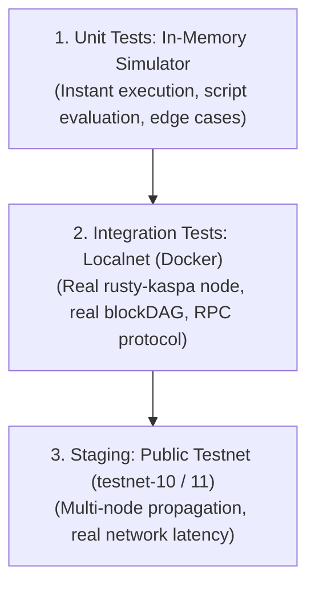

# Testing Kaspa Covenants with Deterministic Simulation

Smart contracts on Kaspa Layer 1 take the form of **covenants**—cryptographic conditions encumbering an Unspent Transaction Output (UTXO) that restrict not only who can unlock the funds, but also enforce strict constraints on the transaction's destination outputs, amounts, and subsequent scripts.

With **Toccata active on Kaspa mainnet since June 30, 2026 (DAA 474,165,565)** and the official release of the **SilverScript v1.0.0 compiler on September 9, 2026**, covenant development is a production reality.

However, testing covenants on a high-throughput BlockDAG introduces unique engineering challenges:
- UTXOs are destroyed upon spending and can never be re-used; test fixtures must generate fresh outputs dynamically.
- Complex covenant conditions (e.g., verifying that a change output remains encumbered by the same contract) require precise introspective script evaluation.
- Testing on public networks is non-deterministic, slow, and exposes test keys and logic publicly before security audits are complete.

This guide provides an end-to-end walkthrough for writing automated, deterministic test suites for Kaspa covenants using **HardKAS** and TypeScript.

---

## The Testing Pyramid: Three Complementary Layers

Testing covenant logic requires different tools depending on the fidelity required:



1. **In-Memory Simulator (`simulated`):** Fast, isolated, deterministic. Executes Kaspa script bytecodes in memory without network overhead. Used for test-driven development (TDD) of covenant contracts.
2. **Managed Localnet (`localnet`):** A real `rusty-kaspa` container running on local simnet. Validates that transaction payloads are accepted by a real node daemon via wRPC.
3. **Public Testnets:** Final end-to-end integration with external wallets and multi-node DAG conditions.

---

## Writing a Covenant Test Suite with the Real HardKAS SDK

Consider an **Escrow Covenant** where deposited funds can only be released to an authorized recipient address when signed by the designated party, or refunded under strict condition checks.

### Step 1: Set Up the Test Suite

Create a test file: `test/covenants/vault.test.ts`:

```typescript
import { describe, it, expect, beforeEach } from 'vitest';
import { Hardkas, type HardkasInstance } from '@hardkas/sdk';

describe('Vault Covenant Security Tests', () => {
  let sdk: HardkasInstance;
  const sampleCovenantScript = '20112233445566778899aabbccddeeff00112233445566778899aabbccddeeffac';

  beforeEach(async () => {
    // Spin up an isolated HardKAS SDK instance in deterministic simulation mode
    sdk = await Hardkas.create({
      execution: { mode: 'simulator', domain: 'kaspa-l1', network: 'simulated' }
    });
  });

  // Test cases follow below...
});
```

---

### Step 2: Test Case 1 (Happy Path) — Authorized Deployment and Spend

Verify that the covenant can be deployed by locking funds to its script, and subsequently spent when all constraints are met:

```typescript
it('allows authorized spending of funds locked in covenant', async () => {
  // 1. Plan deployment of the covenant with 20 KAS
  const deployPlan = await sdk.covenants.planDeploy({
    script: sampleCovenantScript,
    amount: 2_000_000_000n, // 20 KAS in sompi
    from: 'alice',
  });

  // 2. Sign and simulate the deployment in memory
  const signedDeploy = await sdk.tx.sign(deployPlan, 'alice');
  const { receipt: deployReceipt } = await sdk.tx.simulate(signedDeploy);
  expect(deployReceipt.txId).toBeDefined();

  // 3. Plan spending from the covenant UTXO
  const spendPlan = await sdk.covenants.planSpend({
    covenantId: deployReceipt.txId,
    to: 'kaspa:precipient...',
    amount: 1_990_000_000n,
    from: 'alice',
  });

  // 4. Verify transaction plan validity
  const verification = await sdk.tx.verify(spendPlan);
  expect(verification.isValid).toBe(true);
});
```

---

### Step 3: Test Case 2 (Unhappy Path) — Rejecting Insufficient Fee Allocation

The simulator strictly enforces mass and fee bounds. Test that planning a spend that exhausts mass without paying adequate fee is deterministically rejected:

```typescript
it('rejects covenant spending when transaction fee is below mass floor', async () => {
  const deployPlan = await sdk.covenants.planDeploy({
    script: sampleCovenantScript,
    amount: 2_000_000_000n,
    from: 'alice',
  });
  const signedDeploy = await sdk.tx.sign(deployPlan, 'alice');
  const { receipt } = await sdk.tx.simulate(signedDeploy);

  // Attempt to spend with zero fee allocation (amount equals total UTXO value)
  const illegalSpendAttempt = sdk.covenants.planSpend({
    covenantId: receipt.txId,
    to: 'kaspa:precipient...',
    amount: 2_000_000_000n, // Leaves 0 for transaction mass fee
    from: 'alice',
  });

  // The planner rejects the transaction due to missing fee coverage
  await expect(illegalSpendAttempt).rejects.toThrow();
});
```

---

## Generating Verifiable Evidence Packages

When tests pass in HardKAS, you can export the exact transaction steps into an auditable **Evidence Package**:

```bash
hardkas artifact create --name vault-audit-run
```

This creates a structured JSON artifact containing:
- Exact UTXO inputs and script public keys.
- Output commitments and computed transaction mass.
- Simulation environment parameters and engine hashes.

Other team members or external auditors can independently re-validate the test execution using:

```bash
hardkas replay verify --artifact .hardkas/artifacts/vault-audit-run.json
```

---

## Realistic Security Posture: What Local Testing CAN and CANNOT Prove

Responsible smart contract engineering requires understanding the exact boundaries of local simulation:

### What Local Deterministic Testing PROVES:
✅ **Script Logic Validity:** Confirms that the script opcodes, cryptographic signatures (Schnorr), and timelocks execute without runtime errors.  
✅ **Constraint Enforcement:** Proves that illegal destination outputs or unauthorized spenders trigger deterministic script failures.  
✅ **Mass Limits:** Ensures that transaction mass does not exceed the standard consensus limits for single transactions.

### What Local Testing CANNOT Prove:
❌ **Consensus Acceptance:** A local test confirms compliance with protocol rules, but it does **not** guarantee that a public node will accept or prioritize the transaction if miner fee policies change.  
❌ **Double-Spend Immunity on Live Networks:** While the simulator prevents double-spending within your local test fixture, only the distributed PoW consensus of the BlockDAG determines winner transactions during simultaneous broadcast race conditions.  
❌ **Reorg and Orphan Resilience:** Local simulation does not model network partitions, deep DAG splits, or propagation latency across hundreds of global nodes. Staging tests on public testnets remain necessary.

---

## Running the Test Suite and Diagnostics

Execute your covenant tests via the HardKAS test runner:

```bash
hardkas test
```

To run diagnostics and verify local toolchain readiness before deploying:

```bash
hardkas doctor workspace
```

---

## Related Documentation

- [SilverScript IDE & Local Development](./silverscript-ide-and-local-development.md)
- [Kaspa L1 Development Framework](../concepts/kaspa-l1-development-framework.md)
- [Execution Contracts & Evidence Architecture](../concepts/execution-contract.md)
- [Kaspa Protocol Documentation](https://docs.kaspa.org)
