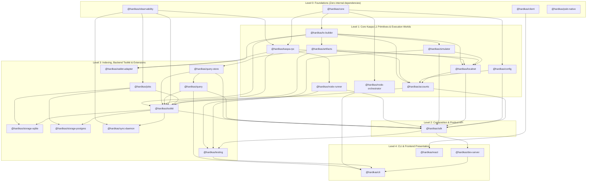

# Architecture & Dependency Graph

HardKAS enforces a strict 5-layer Directed Acyclic Graph (DAG) across its packages so that lower-level protocol primitives never depend on higher-level orchestration or UI layers, and browser frontends remain isolated from Node.js server dependencies.

---

## Layer Responsibilities

### Level 0 — Foundations
- **`@hardkas/core`**: Canonical types, branded identifiers (`TxId`, `ArtifactId`, `KaspaAddress`), error taxonomy, and cryptographic hashing.
- **`@hardkas/observability`**: Structured logging, correlation IDs, and telemetry streams.
- **`@hardkas/client`**: Zero-dependency HTTP/SSE client for browser environments.
- **`@hardkas/pskt-native`**: Native Rust NAPI bindings for Partially Signed Kaspa Transactions (PSKT). On hold and not published; `@hardkas/sdk` does not depend on it.

### Level 1 — Core Primitives & Execution Worlds
- **`@hardkas/config`**: Workspace configuration loader (`hardkas.config.ts`) and execution target resolution.
- **`@hardkas/tx-builder`**: UTXO selection, KIP-9 mass calculation (Compute, Storage, and Transient mass), Schnorr signing, SilverScript/Covenant script builders, and ZK precompile script construction.
- **`@hardkas/artifacts`**: Immutable schemas and SHA-256 lineage verification for `TxPlan`, `SignedTx`, `TxReceipt`, and Evidence Packages.
- **`@hardkas/kaspa-rpc`**: Resilient wRPC / JSON-RPC client for `rusty-kaspa` (`kaspad`) nodes.
- **`@hardkas/simulator`**: Deterministic in-memory BlockDAG and Kaspa Script VM for instant unit testing.
- **`@hardkas/node-runner` & `@hardkas/node-orchestrator`**: Managed `kaspad` binary lifecycle and multi-node DAG topology orchestration.
- **`@hardkas/localnet`**: Unified local execution engine bridging the in-memory simulator and real `kaspad --simnet` nodes.
- **`@hardkas/accounts`**: HD wallet derivation, keystore encryption, and execution-mode authority guards.

### Level 2 — Composition & Product API
- **`@hardkas/sdk`**: The primary developer facade unifying transaction planning, SilverScript (`sdk.silver`), covenants (`sdk.covenants`), ZK verification (` verifyZkProofMath`, `buildR0Groth16Scripts`), localnet control, and querying.

### Level 3 — Indexing, Backend Toolkit & Testing
- **`@hardkas/query-store` & `@hardkas/query`**: Read-only SQLite projection of artifacts, UTXOs, and lineage chains.
- **`@hardkas/toolkit`, `@hardkas/jobs`, `@hardkas/sync-daemon`, `@hardkas/storage-sqlite`, `@hardkas/storage-postgres`**: Production backend primitives for building indexers, merchant checkouts, and custody services.
- **`@hardkas/wallet-adapter`**: Browser and hardware wallet connection adapters.
- **`@hardkas/testing`**: Scenario runner, chaos engine, and reproducible assertion helpers.

### Level 4 — Presentation
- **`@hardkas/cli`**: The `hardkas` command-line interface.
- **`@hardkas/dev-server`**: Local HTTP/SSE developer API server backing `hardkas sandbox`.
- **`@hardkas/react`**: Zero-bloat React hooks (`@hardkas/client` consumer) for Kaspa frontends.
