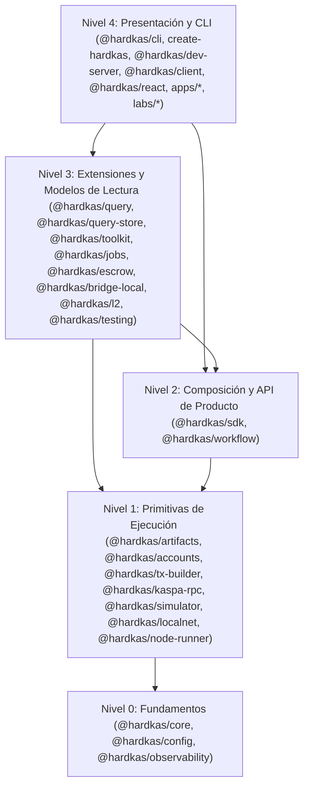

# EVALUACIÓN DE MANTENIBILIDAD Y ARQUITECTURA (`MANTENIBILIDAD.md`) — ISO/IEC 25010:2023

## 1. Resumen Ejecutivo de Mantenibilidad

La característica **Mantenibilidad (Maintainability)** de **ISO/IEC 25010:2023** (*Modularidad*, *Reusabilidad*, *Analizabilidad*, *Modificabilidad* y *Capacidad de ser probado / Testabilidad*) constituye uno de los pilares mejor estructurados de HardKAS `v0.13.0-rc.2` en su diseño arquitectónico, aunque presenta **3 incumplimientos verificables en scripts de control de calidad (gates)** y **deuda de pruebas en paquetes privados retenidos**.

- **Fortalezas verificadas (`VERIFICADO`)**:
  1. **Jerarquía acíclica de 5 niveles (Niveles 0 a 4)** respetada estrictamente en los 35 paquetes (`HK-REQ-011`).
  2. **Sincronización perfecta de versiones (`0.13.0-rc.2`)** en los **6.268 archivos** escaneados por `scripts/check-versions.mjs` (`HK-REQ-064`).
  3. **Registro centralizado de esquemas de artefactos (`hardkas.*`)** verificado por `scripts/check-artifact-registry.mjs` (`HK-REQ-014`).
  4. **Derivación funcional pura del estado transaccional (`deriveTxStatus`)** sin mutación de estado oculto (`HK-REQ-016`).
  5. **Amplia batería de pruebas automatizadas**: **885 archivos `.test.ts`** distribuidos en **9 configuraciones Vitest**, con puerta hermética sin red (`scripts/gate-hermetic.mjs`, `HK-REQ-066`).
- **Incumplimientos y brechas de mantenibilidad (`INCUMPLIDO` / `PARCIAL` / `SIN EVIDENCIA`)**:
  1. **Fallo del gate `scripts/check-typescript-hygiene.mjs` (Exit Code 1, `HK-REQ-069` — `INCUMPLIDO`)**: Se detectaron **2.448 ocurrencias de `any`** en el código de paquetes y múltiples cláusulas `catch (e: any)` pendientes de migrar a `catch (e: unknown)`.
  2. **Fallo del gate `scripts/docs-check.mjs` (Exit Code 1, `HK-REQ-070` — `INCUMPLIDO`)**: **4 enlaces rotos** en documentación interna y comunitaria, incluyendo 2 rutas locales absolutas `C:\Users\jrodr\hkl1\rc2\...`.
  3. **Fallo del gate `pnpm check:artifacts` (`packages/artifacts/test/fixtures/valid`, Exit Code 1, `HK-REQ-071` — `INCUMPLIDO`)**: El directorio de fixtures válidas está vacío (`0 archivos`), provocando que `check-artifact-fixtures.mjs` falle con `the corpus is empty`.
  4. **Paquetes internos con 0 archivos de test (`HK-REQ-058` — `SIN EVIDENCIA`)**: `@hardkas/storage-postgres`, `@hardkas/storage-sqlite`, `@hardkas/plugin-local-indexer`, `@hardkas/simulator-adapters` y `@hardkas/client` tienen **0 suites de pruebas**.
  5. **Cobertura de mención en tests de la superficie pública en 35,2 % (`HK-REQ-072` — `PARCIAL`)**: De los **1.422 símbolos públicos** documentados en `PUBLIC_API_SURFACE.md`, **500** son ejercitados directamente por nombre en archivos de test, más **11 tests omitidos (`[known gap]`)**.

---

## 2. Evaluación por Subcaracterística ISO/IEC 25010:2023

### 2.1 Modularidad y Arquitectura de Niveles (Levels 0–4) (`HK-REQ-011`) — `VERIFICADO`

La regla de arquitectura definida en `.agents/AGENTS.md#L125-L132` y `AI_ARCHITECTURE_RULES.md` divide el monorepo en 5 capas sin ciclos ascendentes:

- **Verificación**: Ningún paquete de Nivel 0 (`core`, `config`, `observability`) ni de Nivel 1 (`artifacts`, `accounts`, `tx-builder`, `kaspa-rpc`, `simulator`, `localnet`) importa paquetes de Nivel 2, 3 o 4. Las fachadas experimentales (`zk`, `l2`, `vprogs`, `covenants`, `dev-server`) están desacopladas de la superficie pública estable por defecto.

### 2.2 Analizabilidad y Trazabilidad Diagnóstica (`HK-REQ-004`, `HK-REQ-009`, `HK-REQ-014`, `HK-REQ-061`) — `VERIFICADO`
- **Errores Estructurados**: `HardkasError` (`packages/core/src/errors.ts#L1-L240`) estandariza códigos de error legibles por máquina (`MAINNET_CONNECTION_DISABLED`, `ARTIFACT_IDENTITY_CONFLICT`, `UTXO_DOUBLE_SPEND`, `NODE_NOT_SYNCED`, etc.), contexto serializable y sugerencias de remediación (`hint`).
- **Trazabilidad de Evidencia**: Cada ejecución de escenario o transacción produce artefactos JSON deterministas con linaje criptográfico (`parentHashes`), verificables mediante `hardkas evidence verify` y auditables mediante `hardkas query-store doctor`.
- **Etiquetado de Madurez en CLI**: Todos los comandos de `@hardkas/cli` declaran explícitamente su nivel de madurez (`stable`, `preview`, `alpha`, `experimental`, `research`, `internal`) y soportan `--json`.

### 2.3 Modificabilidad e Higiene de Código (`HK-REQ-069`, `HK-REQ-070`) — `INCUMPLIDO`
1. **Higiene de Tipos TypeScript (`scripts/check-typescript-hygiene.mjs`)**:
   - La ejecución real del script devolvió **código de salida 1 (FAIL)**.
   - El análisis contabilizó **2.448 apariciones de la palabra clave `any`** en los paquetes y más de un centenar de bloques `catch (e: any)` o `catch (err: any)` en `accounts`, `artifacts`, `cli`, `sdk`, `simulator`, `testing`, `toolkit` y `tx-builder`.
   - Aunque el compilador TypeScript se ejecuta con `"strict": true` en `tsconfig.base.json`, la presencia de `catch (e: any)` contradice la política del propio script de higiene del repositorio y la afirmación en `docs/status/release-claims.md#L82`.
2. **Integridad Documental (`scripts/docs-check.mjs`)**:
   - La ejecución real del script devolvió **código de salida 1 (FAIL)** por **4 enlaces rotos**:
     - `docs/community/rc-0.13.0-rc.1/EVIDENCE_INDEX.md`: enlaces rotos a `X_POST.md` y `DISCORD_ANNOUNCEMENT.md`.
     - `docs/internal/audit/surface-2026-11-09/inventario.md`: **2 enlaces con rutas absolutas locales de Windows** (`C:\Users\jrodr\hkl1\rc2\...`).

### 2.4 Capacidad de ser Probado / Testabilidad (`HK-REQ-058`, `HK-REQ-066`, `HK-REQ-071`, `HK-REQ-072`) — `PARCIAL`
1. **Aislamiento Hermético (`VERIFICADO`)**:
   - `scripts/gate-hermetic.mjs` y `scripts/hermetic/no-network-preload.cjs` interceptan `net.Socket.prototype.connect`, `http`, `https` y `fetch`, bloqueando cualquier salida a Internet y rechazando los puertos wRPC canónicos de Kaspa (`16210`, `17210`, `18210`, `18211`) en `localhost`.
2. **Gate de Fixtures de Artefactos Válidos Vacío (`HK-REQ-071` — `INCUMPLIDO`)**:
   - Mientras que `node scripts/check-artifact-fixtures.mjs packages/artifacts/test/fixtures/corrupted --reject` pasa con **12/12 fixtures corruptas rechazadas**, el comando `node scripts/check-artifact-fixtures.mjs packages/artifacts/test/fixtures/valid` (`pnpm check:artifacts`) **falla con código de salida 1** porque `packages/artifacts/test/fixtures/valid` contiene **0 archivos** (`FAIL - the corpus is empty`), tras haberse purgado las fixtures antiguas al migrar a `hashVersion: 5` sin regenerar el corpus válido.
3. **Cobertura de Símbolos Públicos y Paquetes Privados (`HK-REQ-058`, `HK-REQ-072`)**:
   - En los 21 paquetes publicables de `packages/*`, todos cuentan con suites de pruebas activas (destacando `@hardkas/sdk` con 206 archivos de test, `@hardkas/cli` con 115, `@hardkas/artifacts` con 74, `@hardkas/core` con 59 y `@hardkas/simulator` con 52).
   - Sin embargo, 5 paquetes privados retenidos (`@hardkas/client`, `@hardkas/plugin-local-indexer`, `@hardkas/simulator-adapters`, `@hardkas/storage-postgres`, `@hardkas/storage-sqlite`) tienen **0 archivos de test**.
   - Existen **11 tests omitidos con la etiqueta `[known gap: ...]`** en 10 archivos de prueba (verificados por `scripts/check-known-gaps.mjs`), vinculados a limitaciones documentadas en `docs/status/limitations.md`.
