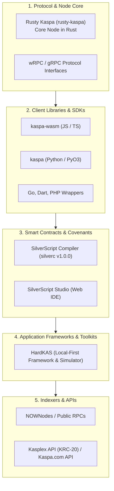

# Kaspa developer tools and ecosystem: a technical guide

This page lists the main developer tools for Kaspa L1 — the rusty-kaspa node, the kaspa-wasm SDK, the SilverScript
compiler, IDEs, frameworks and explorers — and where HardKAS fits. HardKAS is an independent community project, not an
official Kaspa tool.

Building software on Kaspa means working with a high-throughput, parallel **proof-of-work BlockDAG**. Kaspa differs from
linear blockchains: sub-second block intervals, GHOSTDAG consensus (DAGKnight planned), and a UTXO-based transaction
model.

With the **Toccata upgrade activated on Kaspa mainnet on June 30, 2026 (at DAA score 474,165,565)** and the release of the
**SilverScript compiler v1.0.0 on September 9, 2026**, the developer ecosystem has grown.

This directory is a technical overview of the main developer tools, client libraries, infrastructure providers and
frameworks in the Kaspa ecosystem.

---

## Ecosystem architecture overview



---

## 1. Node software and protocol clients

### Rusty Kaspa (`rusty-kaspa`)

- **Role:** the canonical full-node implementation of the Kaspa protocol.
- **Language:** Rust.
- **Key features:** high-performance block processing, memory-efficient DAG storage, native WebSocket RPC (`wRPC`).
- **Use case:** running a node, private localnets, protocol research.
- **Repository:** [github.com/kaspanet/rusty-kaspa](https://github.com/kaspanet/rusty-kaspa)

### wRPC (WebSocket RPC)

- **Role:** the protocol for querying nodes and submitting transactions.
- **Formats:** Borsh-serialized binary encoding for speed, or JSON for web integrations.
- **Documentation:** [docs.kaspa.org](https://docs.kaspa.org)

---

## 2. Official and community SDKs

### `kaspa-wasm` (JavaScript / TypeScript)

- **Role:** the official WebAssembly SDK exposing Rusty Kaspa's primitives.
- **Runs in:** browsers, Node.js and web workers.
- **Key features:** RPC client, address generation, transaction construction and signing, serialization.
- **Best for:** web wallets, front-end integrations, client-side signing.
- **Repository:** [github.com/kaspanet/rusty-kaspa/tree/master/wasm](https://github.com/kaspanet/rusty-kaspa/tree/master/wasm)

### `kaspa` (Python)

- **Role:** a Python module with native Rust bindings through PyO3 and Maturin.
- **Key features:** RPC client, key management, script construction.
- **Best for:** analytics, bots and backend scripting.

### Community client libraries

- **Go (`kaspa-go`):** community bindings for Go services.
- **Dart / Flutter (`kaspa_dart`):** cryptographic libraries used mainly by mobile wallets (such as Kaspium).

---

## 3. Smart contract and covenant languages

### SilverScript compiler (`silverc`)

- **Role:** the official language and compiler for Kaspa covenants and UTXO spending scripts.
- **Current version:** `v1.0.0` (released September 9, 2026).
- **Architecture:** compiles `.sil` contracts into Kaspa script that locks transaction outputs.
- **Consensus relationship:** the compiled script runs under Toccata's consensus rules (active on mainnet since June 30,
  2026, at DAA 474,165,565).
- **Use case:** escrows, timelocks, multisig conditions, payment vaults.

### SilverScript Studio

- **Role:** a browser-based development environment for SilverScript.
- **Key features:** syntax highlighting, contract templates (multisig, timelocks), compilation, testnet deployment.
- **Best for:** prototyping, learning, inspecting contracts in the browser.

---

## 4. Application frameworks and local toolkits

### HardKAS

- **Role:** an open-source, community-led development framework and test toolkit for native Kaspa L1, maintained by
  KasLabDevs.
- **Language / runtime:** TypeScript on Node.js 24.22.1 (exactly).
- **Key features:**
  - **In-memory simulator:** deterministic payment flows over synthetic UTXOs, with no node and no network latency. It does
    not execute Kaspa script.
  - **Localnet node orchestration:** one command manages a real `rusty-kaspa` node on simnet in Docker
    (`hardkas localnet start --toccata`).
  - **Verifiable artifacts:** every transaction step writes a content-addressed JSON artifact (plan, signed transaction,
    receipt or submission), verified offline with `hardkas artifact verify`.
  - **SilverScript and covenants:** the pinned `silverc`, P2SH deploy and spend, and Toccata covenants on a node you run
    (`hardkas silver`).
  - **Diagnostics:** node and workspace health checks (`hardkas rpc health`, `hardkas doctor`).
  - **Test runner:** Vitest integration for CI pipelines (`hardkas test`).
- **Networks:** the simulator, simnet, and testnet-10 behind an opt-in. Mainnet is locked down: no keys, no connection,
  no broadcast.
- **Best for:** backend developers, wallet engineers, payment teams and covenant authors who need reproducible local
  testing.
- **Repository:** [github.com/KasLabDevs/HardKas](https://github.com/KasLabDevs/HardKas)

---

## 5. Infrastructure providers, public RPCs and indexers

### NOWNodes

- **Role:** an infrastructure provider offering shared and dedicated Kaspa RPC endpoints.
- **Use case:** applications that choose not to run their own full node.

### Kasplex API (KRC-20, Kasplex L1)

- **Role:** an indexer and data API for the KRC-20 token standard and inscriptions on Kaspa.
- **Note:** Kasplex L1 (native assets, KRC-20) is distinct from Kasplex L2 (an EVM rollup). KRC-20 is also distinct from
  KCC-20, whose balances are covenant UTXOs ([KCC support in HardKAS](../reference/kcc.md)).
- **Use case:** wallets, token analytics, marketplace backends.

---

## 6. Network explorers and diagnostics

| Tool | Focus | URL |
|---|---|---|
| **Kaspa Official Explorer** | Real-time BlockDAG view, address balances, transaction tracking | `explorer.kaspa.org` |
| **Katnip Explorer** | Extended analytics, KRC-20 tracking, DAG metrics | `katnip.kaspad.net` |
| **Kaspa Graph Inspector** | Visualization of DAG topology and blue scores | Community-hosted |

---

## How to choose your Kaspa development stack

```text
1. Web wallet / front-end dApp:
   → kaspa-wasm + a browser wallet extension + public wRPC

2. Backend service / merchant payment processor:
   → HardKAS (testing and planning) + rusty-kaspa (localnet node) + TypeScript

3. Smart contracts and covenants:
   → SilverScript (silverc) + HardKAS on your own simnet node (the node runs the script)

4. Analytics and data pipelines:
   → Python (kaspa) + Rusty Kaspa gRPC + Kasplex indexer
```

---

## Technical disclaimers

1. **Independent directory.** This directory is educational. HardKAS is an independent community project, not the official
   foundation tool or the only developer tool for Kaspa.
2. **Layer 1 vs. Layer 2.** Kaspa L1 does not execute Solidity or EVM bytecode. For EVM applications, look at ecosystem
   Layer 2 projects (such as Igra or Kasplex L2; both are outside the HardKAS L1 core).
3. **Supported vs. experimental in HardKAS.** 1:1 auth-bound covenant transitions (`silver covenant genesis`,
   `transition`) and payment simulation are supported; 1:N, N:M and termination (`silver covenant start`, `advance`) are
   experimental. vProgs (inspect-only) and the ZK tools are experimental research prototypes, not production
   infrastructure.

---

## Related documentation and official resources

- [Kaspa L1 Development Framework](./kaspa-l1-development-framework.md)
- [Hardhat for Kaspa (EVM to Kaspa guide)](../guides/hardhat-for-kaspa.md)
- [5-Minute Quickstart](../start/quickstart.md)
- **Kaspa official documentation:** [docs.kaspa.org](https://docs.kaspa.org)
- **Kaspa community hub:** [kaspahub.org](https://kaspahub.org)
- **Kas-Smiths builder forum:** [kas-smiths.org](https://kas-smiths.org)
- **Kaspa Improvement Proposals:** [github.com/kaspanet/kips](https://github.com/kaspanet/kips)
