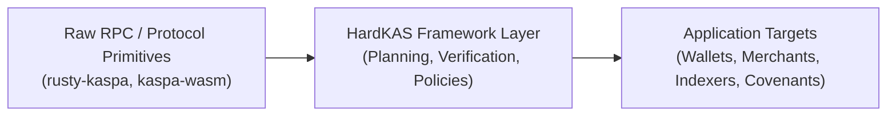
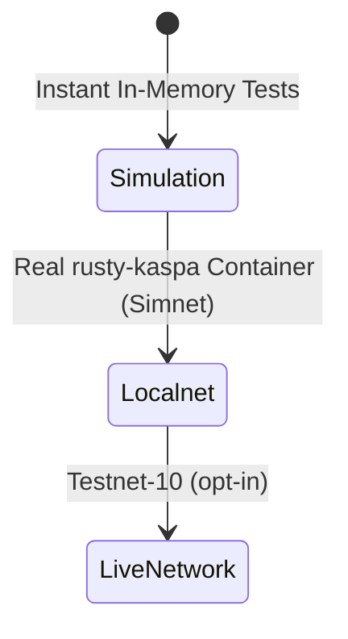

# Kaspa L1 Development Framework: architecture and engineering guide

HardKAS is an open-source, local-first development framework for Kaspa L1. This page explains how it is built: the
simulated ledger, the local rusty-kaspa node and the artifacts it records.

Building applications, payment infrastructure and covenant logic natively on Kaspa Layer 1 differs from both single-chain
UTXO systems (like Bitcoin) and account-based virtual machines (like Ethereum). Kaspa runs on the **GHOSTDAG BlockDAG**
(DAGKnight planned), which gives high-throughput parallel blocks and fast confirmations under proof-of-work.

With the **Toccata upgrade activated on Kaspa mainnet on June 30, 2026 (at DAA score 474,165,565)** and the release of the
**SilverScript compiler v1.0.0 on September 9, 2026**, Kaspa L1 has native covenants.

Developing directly against raw RPC nodes is still hard work:

- UTXO selection, change outputs and mass calculation are yours to manage.
- Testing transaction scripts against live networks is slow, non-deterministic and exposed to other people's activity.
- Preparation, signing and verification are often bundled into opaque routines that leave no auditable record.

**HardKAS** is an open-source, community-led, local-first development framework for Kaspa L1, built by KasLabDevs. It
provides the tooling, a deterministic simulator and reproducible artifacts to develop and test Kaspa applications before
they reach a public network. HardKAS does not claim mainnet production readiness, and mainnet is locked down in this
release.

---

## Why Kaspa L1 needs a development framework

Direct RPC access through `rusty-kaspa`, or bindings through `kaspa-wasm`, gives you protocol primitives, not an
application framework. Backends, payment processors and covenant workflows need more:

1. **State isolation.** Public testnets bring other people's UTXO activity, network latency and reorgs into local
   iteration.
2. **Checks before the broadcast.** Fee, mass and standardness can be checked before a transaction leaves your machine;
   script and covenant conditions are judged by a node, so they are tested on a node you run.
3. **Auditability and lineage.** Every step (planning, fees, signing, sending) should leave a record that can be verified
   and inspected in CI.



---

## Core architecture: local-first, UTXO-native, deterministic

### 1. Deterministic simulation

HardKAS includes an in-memory Kaspa transaction simulator. It plans, signs and applies payments over synthetic UTXOs
without a node, which gives millisecond feedback in unit tests. It does not execute Kaspa script and is not
consensus-equivalent: script and covenant logic are tested on a simnet node.

### 2. Artifacts and evidence

Every transaction step in HardKAS writes a JSON artifact: a plan, a signed transaction, and a receipt (simulator) or a
submission (node). Each one records:

- the exact inputs and outputs;
- the fee and mass;
- its execution target (mode, domain and network);
- lineage links to the artifacts it came from.

An artifact's id is its content hash. `hardkas artifact verify` checks artifacts offline, and with `--url` asks a node how
deep the transaction is. A simulator run can also be replayed deterministically from its receipt (by artifactId or
path); a real-node send is not replayed:

```bash
hardkas replay verify <receipt>
```

### 3. Separate execution worlds

HardKAS keeps its execution targets apart so that nothing leaks from one environment to another:



- **Simulation (`simulated`):** in-memory synthetic state, for fast unit tests of payment flows (no Kaspa script runs
  here).
- **Localnet (`localnet`):** a real `rusty-kaspa` node in Docker, mining real blocks on simnet
  (`hardkas localnet start --toccata`).
- **Public testnet (`testnet-10`):** experimental, behind an explicit opt-in in the workspace config (`experimental` and
  `network.allowPublic`). Public test funds only.
- **Mainnet** is locked down: no keys, no connection, no broadcast.

A signed artifact carries its execution target: sending it with another `--network` or `--target` is refused
(`EXECUTION_NETWORK_MISMATCH`, `EXECUTION_TARGET_MISMATCH`).

---

## Developer workflow: from scaffold to verification

### Step 1: scaffold a workspace

```bash
npx @hardkas/cli init my-kaspa-app
cd my-kaspa-app
npm install
```

[Install HardKAS](../start/installation.md) shows how to pin the release. `init` writes:

```text
my-kaspa-app/
├── hardkas.config.ts      # Execution targets and networks
├── package.json           # @hardkas/sdk, and @hardkas/cli + @hardkas/testing as dev dependencies
├── vitest.config.ts
├── test/payment.test.ts   # A first payment test (Vitest / HardKAS SDK)
├── .gitignore
└── .hardkas/              # Simulator state, accounts alice…erin (1000 KAS each), and artifacts/
```

It also installs the `kaspa-wasm` build this release pins, which planning and signing use.

### Step 2: plan a transaction deterministically

Build a plan without touching a private key or a network (amounts are in KAS):

```bash
npx hardkas tx plan --from alice --to bob --amount 5 --network simulated --out tx-plan.json
```

The plan artifact records the UTXOs selected, the fee and the outputs.

### Step 3: verify and inspect

```bash
npx hardkas artifact inspect tx-plan.json
npx hardkas artifact verify tx-plan.json --strict
```

### Step 4: run the tests

```bash
npx hardkas test
```

`hardkas test` runs the project's tests with Vitest and the HardKAS test helpers. The SDK runs the same lifecycle from
code ([Quickstart](../start/quickstart.md#4-sdk-workflow)), and [Build on your own simnet](../start/build-on-simnet.md)
runs it against a real node.

---

## Execution guards and safety policies

Developer errors can have irreversible consequences on a public network: spending the wrong UTXO, broadcasting from an
integration test, exceeding a mass limit. HardKAS enforces guards:

- **Mainnet lockdown (`BLOCKED_BY_POLICY`):** mainnet is locked down in this release: no connection (reads included, even
  to an endpoint you declare), no signing, no broadcast; no flag, option or configuration enables it
  (`MAINNET_CONNECTION_DISABLED`, `MAINNET_SIGNING_DISABLED`, `MAINNET_BROADCAST_DISABLED`).
- **Pending spends:** on a node, the planner looks at the node's mempool once and leaves out every output the sender's
  pending transactions are already spending, and re-checks at the node that each selected input is still unspent.
- **Network binding:** an artifact made for one network or target is refused on another.

---

## Technical boundaries and limits

1. **Not a consensus node.** HardKAS drives and talks to `rusty-kaspa`; it does not implement Kaspa consensus. Block
   validity is decided by consensus nodes only.
2. **Not an EVM compatibility layer.** Kaspa Layer 1 is a UTXO BlockDAG. HardKAS does not simulate Ethereum accounts,
   EVM bytecode or Ethereum state on L1.
3. **Local records vs. consensus acceptance.** HardKAS artifacts show what was planned, signed and sent, and that the
   records are intact. They are not a proof of inclusion or finality in the public BlockDAG; only the network's
   confirmations are.
4. **Covenant scope.** HardKAS builds 1:1 auth-bound covenant transitions (`silver covenant genesis`, `transition`), local
   inspection and validation, and, experimentally, 1:N, N:M and termination (`silver covenant start`, `advance`). It does
   not claim support for arbitrary unbounded multi-state covenants. See
   [SilverScript and Toccata covenants](../guides/silverscript-covenants/index.md).
5. **Experimental modules (vProgs and ZK).** vProgs (offline artifact inspection only) and the ZK tools are experimental
   and local, not production infrastructure. Both ship in the default SDK entry.

---

## Related documentation and official sources

- [5-Minute Quickstart](../start/quickstart.md)
- [Execution worlds](./execution-worlds.md)
- [Artifacts and evidence](./artifacts-and-evidence.md)
- [Hardhat for Kaspa](../guides/hardhat-for-kaspa.md)
- **Official Kaspa node (Rusty Kaspa):** [github.com/kaspanet/rusty-kaspa](https://github.com/kaspanet/rusty-kaspa)
- **Kaspa protocol documentation:** [docs.kaspa.org](https://docs.kaspa.org)
- **HardKAS repository:** [github.com/KasLabDevs/HardKas](https://github.com/KasLabDevs/HardKas)
- **Kaspa Improvement Proposals** (Toccata: KIPs 16, 17, 20 and 21): [github.com/kaspanet/kips](https://github.com/kaspanet/kips)
