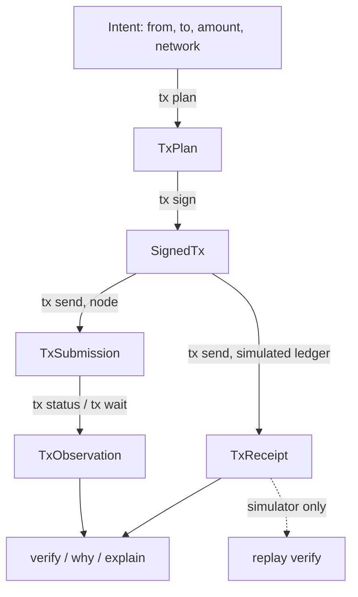

# Transaction lifecycle

A HardKAS transaction is not one opaque RPC call. Each stage writes an artifact, each artifact names the one before
it, and every stage checks the previous artifact before it uses it. The chain is one-way: you never edit an artifact,
you make the next one (or plan again).

The commands are the same on the simulated ledger (`--network simulated`) and on a node (`simnet`, `devnet`,
`testnet-10`); what each stage proves is not. Mainnet is locked down: no keys, no connection, no broadcast.
[Plan, sign and send a transaction](../guides/transactions/plan-sign-send.md) is the step-by-step guide.

## 1. Intent

There is no `TransactionIntent` class: the intent is the arguments of `hardkas tx plan` or the SDK's `sdk.tx.plan()`.

- **Sender** (`--from`, `from`): an account name or an address.
- **Recipient** (`--to`, `to`): an account name or an address. `tx plan` can pay several recipients in one
  transaction (`--to <recipient>=<kas>`, repeated; the SDK's `outputs`).
- **Amount**: in KAS, up to 8 decimals (1 KAS = 100,000,000 sompi). On the CLI `--amount <kas>`; in the SDK
  `amount: "10"` is 10 KAS (a `bigint` is read as sompi).
- **Network**: `--network` (`simulated`, `simnet`, `devnet`, `testnet-10`, `testnet-12`), else the workspace's
  default target. Mainnet is refused before anything connects.
- **Change**: `--change` (`changeAddress` in the SDK); the sender when omitted.

## 2. Plan (`TxPlan`)

- **Who decides.** The pinned `kaspa-wasm` Generator selects the inputs, computes mass and fee and makes the change,
  for the simulator and for a node. HardKAS adds the safety around it: on a node it leaves out immature coinbase
  outputs and outputs a mempool transaction is already spending, and re-checks at the node that each selected input is
  still unspent (`SELECTED_UTXO_INVALIDATED` after the bounded retries). See
  [Fees, mass and UTXOs](../guides/transactions/fees-and-mass.md).
- **Artifact.** A `hardkas.txPlan` under `.hardkas/artifacts/plans/` (and `--out`): inputs, outputs, fee, mass,
  the execution target (mode, domain, network) and `plannerAuthority` (`KASPA_WASM_GENERATOR` for a node,
  `SYNTHETIC_SIMULATOR` for the simulator). Its `artifactId` is its content hash; its `planId` is a short label
  derived from it.
- **Fails when** no spendable output is left (`NO_SPENDABLE_UTXOS`) or the funds are short, the payment does not fit one standard
  transaction (`MULTI_TRANSACTION_PLAN_REQUIRED`), the change or an output is too small for a standard output
  (`CHANGE_BELOW_STANDARD_OUTPUT`, `OUTPUT_BELOW_STANDARD_AMOUNT`), the fee is above the limit (`FEE_EXCEEDS_MAX`), or
  the node is unreachable.
- **Proves:** with the outputs the network (or the simulated ledger) reported at that moment, a transaction paying the
  amount and its fee could be built.
- **Does not prove:** that the sender authorized it, or that its inputs will still be unspent when it is sent.

A plan names its network. Sending it through another one is refused (`EXECUTION_NETWORK_MISMATCH`).

## 3. Sign (`SignedTx`)

- **Checks first.** `tx sign` refuses a plan whose content no longer hashes to its content hash
  (`ARTIFACT_HASH_MISMATCH`, nothing signed) and checks the plan's fee against its fee limit.
- **Who signs.** On a node, the account's key signs each input (Schnorr by default, ECDSA for an ECDSA account). On
  the simulated ledger HardKAS writes a synthetic authorization by the plan's sender: no Kaspa signature exists. On
  mainnet nothing is signed (`MAINNET_SIGNING_DISABLED`).
- **Artifact.** A `hardkas.signedTx` under `.hardkas/artifacts/signed/` whose `lineage.parentArtifactId` is the plan's
  `artifactId`. The transaction id is fixed once signed.
- **Proves:** the holder of the account's key authorized exactly that plan (on the simulated ledger: that the plan's
  sender did).
- **Does not prove:** that a node will accept it, or that no competing transaction has spent its inputs.

## 4. Send (`TxReceipt` or `TxSubmission`)

- **Checks first.** `tx send` checks the signed artifact's hash before contacting anything and sends it to the network
  its plan names. On a network other than `simulated` and `simnet` it needs `--yes`
  (`TX_SEND_CONFIRMATION_REQUIRED` otherwise). Sending the same signed transaction again sends nothing.
- **Artifact.** Under `.hardkas/artifacts/receipts/`:
  - the **simulated ledger** applies the transaction to `.hardkas/localnet.json` and writes a `TxReceipt`;
  - a **node send** writes a `TxSubmission` (`hardkas.txSubmission.v1`): what the node answered, the submit point,
    the endpoint and the lineage. It carries the Kaspa `txId`.
- **Proves:** on the simulated ledger, that the ledger applied it. On a node, that the node accepted the submit
  request (`SUBMITTED`).
- **Does not prove:** that the DAG accepted the transaction, that it is confirmed, or that it is final. A simulated
  receipt is never network evidence.

## 5. Observe (`TxObservation`): node only

- **Commands.** `hardkas tx status <txId>` takes one new look at the node; `hardkas tx wait <txId>` keeps looking
  until the transaction is `ACCEPTED` or `CONFIRMED` (`--until`), then until the node's UTXO view reflects it;
  `hardkas tx send <signed> --wait` does the same right after the send.
- **States.** Derived from every observation recorded so far: `SUBMITTED`, `MEMPOOL_ACCEPTED`, `ACCEPTED`, then
  `CONFIRMED` at 100 blue-score confirmations (a HardKAS policy, not a Kaspa parameter); `FINALIZED` and `REORGED`
  also exist.
- **Artifact.** Each look is a `hardkas.txObservation.v1` under `.hardkas/artifacts/observations/`.
- **Proves:** one node, at one moment, saw the transaction at that state and depth.
- **Does not prove:** irreversible finality, or agreement between several nodes.

A simulator transaction has no network to observe: its state comes from its `TxReceipt`.
[Reading receipts and verification levels](../start/receipts-and-levels.md) explains each state.

## 6. Verify, explain, replay

- `hardkas verify <artifact>` recomputes the artifact's hash and checks its schema and the lineage it declares.
- `hardkas artifact verify <artifact> --network <name> --require consensus` checks the transaction against a node of
  its own network.
- `hardkas why <artifactId>` walks the lineage back to the plan; `hardkas explain <artifactId>` describes an
  artifact. A bare `txId` is not an artifact locator (`NAMESPACE_REQUIRED`): use `hardkas explain --tx <txId>`.
- `hardkas replay verify <receipt>` replays a simulator receipt deterministically. A node send cannot be replayed: it
  records a `TxSubmission`, not a `TxReceipt`.

<!-- qualification: artifacts -->
