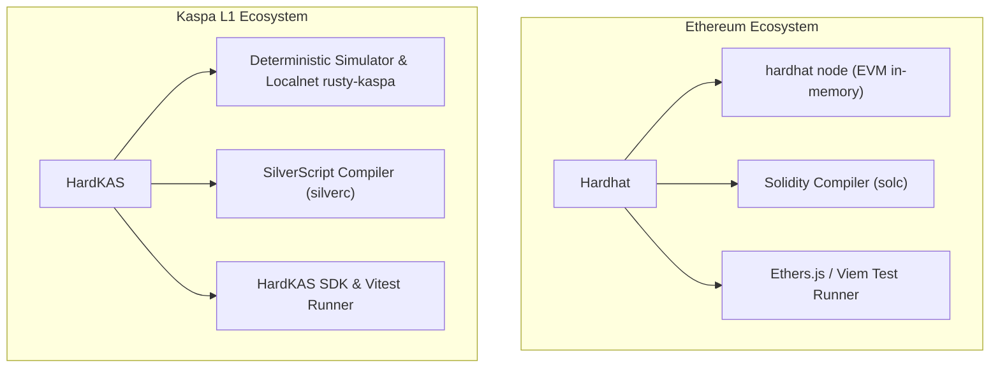

# Hardhat for Kaspa: a developer's guide to building on Kaspa L1

HardKAS plays a similar role on Kaspa L1 to Hardhat on Ethereum: a CLI and TypeScript SDK, a local node (a rusty-kaspa
simnet in Docker) and automated tests. It is not a port of Hardhat and runs no EVM: Kaspa L1 is a UTXO BlockDAG.

If you come from Ethereum, you know **Hardhat**: the local environment for compiling Solidity, running automated tests,
running a local node (`hardhat node`) and scripting deployments.

Developers exploring Kaspa often search for *"Hardhat for Kaspa"*. But Kaspa Layer 1 is **not an EVM chain**: it is a
proof-of-work BlockDAG built on unspent transaction outputs (**UTXOs**), with native covenants. The **Toccata upgrade
activated on Kaspa mainnet on June 30, 2026 (DAA score 474,165,565)** and brought covenants; the **SilverScript compiler
v1.0.0** was released on **September 9, 2026**.

**HardKAS** is an open-source, local-first development framework for Kaspa L1. It gives Ethereum developers what they
expect from Hardhat (a typed config file, a local node, automated tests, reproducible workflows) while keeping Kaspa's own
model.

---

## The paradigm shift: EVM accounts vs. Kaspa's UTXO BlockDAG

| Dimension | Ethereum / Hardhat | Kaspa L1 / HardKAS |
|---|---|---|
| **State architecture** | Accounts with global mutable contract storage | UTXOs: outputs are consumed whole and recreated |
| **Execution topology** | One linear chain | Parallel BlockDAG (GHOSTDAG; DAGKnight planned) |
| **Contract logic** | Solidity / Vyper on the EVM | SilverScript (`.sil`) compiled to UTXO spending scripts and covenants |
| **State mutation** | Changing contract variables with gas-paying transactions | Locking outputs with spending conditions |
| **Local node** | `hardhat node` (in-memory EVM) | `hardkas localnet start --toccata` (a real `rusty-kaspa` node on simnet, in Docker) |
| **Fast in-memory testing** | Hardhat Network | HardKAS's deterministic simulator |
| **What a transaction leaves** | A transaction hash and the gas used | Artifacts (plan, signed transaction, receipt or submission) with lineage, fee and mass, verified offline by `hardkas artifact verify` |
| **Configuration file** | `hardhat.config.js` / `hardhat.config.ts` | `hardkas.config.ts` |

---

## Architectural comparison: Hardhat vs. HardKAS



### 1. Configuration: `hardkas.config.ts`

Hardhat keeps networks and compiler settings in one config file; HardKAS has a typed `hardkas.config.ts`.
`npx @hardkas/cli init` writes this one:

```typescript
import { defineHardkasConfig } from "@hardkas/sdk";

export default defineHardkasConfig({
  execution: {
    default: "simulator",
    targets: {
      simulator: {
        mode: "simulator",
        domain: "kaspa-l1",
        network: "simulated"
      },
      localnet: {
        mode: "localnet",
        domain: "kaspa-l1",
        network: "simnet"
      }
    }
  },

  // Strict execution policy
  network: {
    allowPublic: false
  },
  artifacts: {
    deterministic: true
  },
  experimental: false,

  networks: {
    simulated: {
      kind: "simulated",
      description: "Pure local simulation — no Docker, no RPC, no node"
    },

    simnet: {
      kind: "kaspa-node",
      network: "simnet",
      rpcUrl: "ws://127.0.0.1:18210",
      description: "Local Docker kaspad on simnet — requires hardkas localnet start --toccata"
    }
  }
});
```

`init` writes the same object as a plain `export default { … }` that imports nothing, so the config loads before
`npm install`; once `@hardkas/sdk` is installed, wrap it in `defineHardkasConfig` (as above) for editor types.
`execution` names the targets a command can run on (the simulator by default); `networks` describes each network
(`kind`: `simulated`, `kaspa-node`, `kaspa-rpc` or `igra`). A public testnet (`testnet-10`) needs `experimental: true` and
`network.allowPublic: true`. Mainnet is locked down whatever the config says.

### 2. Local node and fast simulation

- In Hardhat, `npx hardhat node` starts a local JSON-RPC server with pre-funded accounts.
- In HardKAS you have two options:
  1. **The in-memory simulator:** used directly by tests for fast payment flows, with no external process. It does not
     execute Kaspa script. `init` creates five simulated accounts, `alice` to `erin`, with 1000 KAS each.
  2. **The managed localnet:** a real `rusty-kaspa` node in Docker, mining blocks locally on simnet:
     ```bash
     hardkas localnet start --toccata
     hardkas localnet status
     hardkas localnet stop
     ```

### 3. Automated tests with the HardKAS SDK

Instead of deploying contracts to an EVM account and calling their methods, a Kaspa L1 test checks that a transaction
spends the right outputs and that its amounts, change and fee add up:

```typescript
import { describe, it, expect } from "vitest";
import { Hardkas } from "@hardkas/sdk";

describe("Payment transaction pipeline", () => {
  it("plans, signs and simulates a 5 KAS payment", async () => {
    // 1. The HardKAS SDK on the in-memory simulator
    const sdk = await Hardkas.create({
      cwd: process.cwd(),
      autoBootstrap: true,
      network: "simulated"
    });

    // 2. Plan a payment (amounts are in KAS)
    const plan = await sdk.tx.plan({
      from: "alice",
      to: "bob",
      amount: "5"
    });

    // 3. Sign it
    const signed = await sdk.tx.sign(plan, "alice");

    // 4. Apply it to the simulator
    const { receipt } = await sdk.tx.simulate(signed);
    expect(receipt.txId).toBeDefined();
  });
});
```

In a project `init` created, `npx hardkas test` runs the tests with Vitest and the HardKAS test helpers. To run the same
lifecycle against a real node, see [Build on your own simnet](../start/build-on-simnet.md).

---

## What about Kaspa Layer 2s and EVM compatibility?

Can Hardhat itself be used on Kaspa?

1. **Kaspa Layer 1 (the base layer):**
   - Kaspa L1 is a UTXO BlockDAG. It does **not** execute Solidity or EVM bytecode.
   - For L1 applications (wallets, payment processors, covenants, SilverScript), you use **HardKAS**.
2. **Kaspa Layer 2 networks (for example Igra, Kasplex L2):**
   - Several ecosystem projects build EVM-compatible Layer 2s that use Kaspa L1 for sequencing and data availability.
     Proof-based settlement and trustless exits are not live for every L2: check each project's current bridge phase.
   - On those Layer 2s you **can** use Hardhat and Solidity, with the L2's RPC endpoint in `hardhat.config.js`.

HardKAS focuses on the **Layer 1 foundation**: Kaspa's own primitives, not an EVM facade over the BlockDAG.

---

## Common pitfalls for EVM developers on Kaspa

1. **There is no global contract address.** Covenants are spending scripts on specific UTXOs, not programs stored at a
   fixed address, and a covenant's address changes with its state.
2. **Double-spend protection is UTXO-based.** Ethereum orders transactions by account nonce. A Kaspa transaction names the
   outputs it spends (`txId:outputIndex`); two transactions spending the same output cannot both be accepted.
3. **Mass instead of gas.** Kaspa prices a transaction by its **mass**: compute mass (size, signature operations and, in
   transaction v1, the declared compute budget) and storage mass. HardKAS computes it before submission.

---

## Boundaries and limits

- **HardKAS is not Hardhat.** It is an independent framework for Kaspa L1, not a plugin or fork of Nomic Foundation's
  Hardhat.
- **Simulation is not consensus.** The simulator runs no Kaspa script and is not consensus-equivalent: a pass there says
  nothing about node acceptance. Test script and covenant logic on a simnet node; only the Kaspa network establishes
  ordering and DAG inclusion.
- **No mainnet at all.** Mainnet is locked down in this release: no connection (reads included, even to an endpoint you
  declare), no signing, no broadcast; no flag, option or configuration enables it (`MAINNET_CONNECTION_DISABLED`,
  `MAINNET_SIGNING_DISABLED`, `MAINNET_BROADCAST_DISABLED`). The experimental `@hardkas/l2` package refuses L2 mainnet
  writes too, whatever `allowMainnet` / `--allow-mainnet` say (`L2_MAINNET_WRITE_BLOCKED`).

---

## Related

- [Kaspa L1 Development Framework](../concepts/kaspa-l1-development-framework.md)
- [5-Minute Quickstart](../start/quickstart.md)
- [Configuration](../start/configuration.md)
- [Execution worlds](../concepts/execution-worlds.md)
- [SilverScript and Toccata covenants](./silverscript-covenants/index.md)
- [Kaspa Improvement Proposals (KIPs)](https://github.com/kaspanet/kips)
