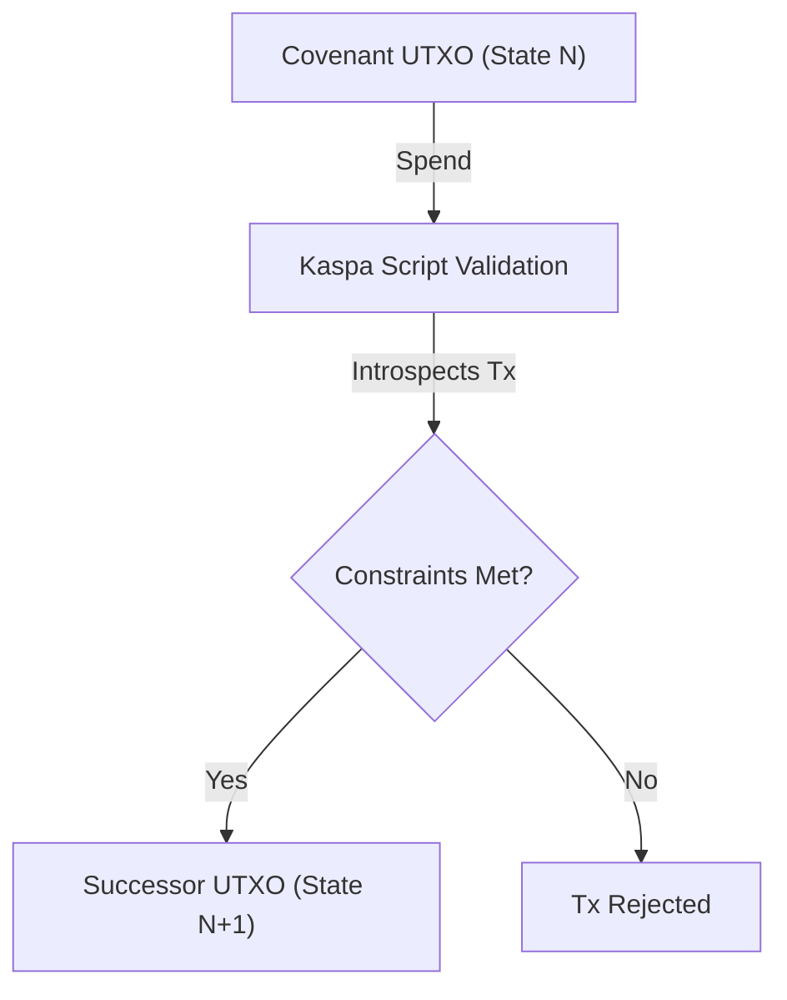

# The covenant model

A Kaspa covenant is not an EVM smart contract. There is no contract account at a fixed address holding state.

## What a covenant is

A covenant is a constraint placed on a UTXO. It says:

1. **how** the UTXO may be spent (for example, with a given signature);
2. **what** successor outputs the spending transaction must create (for example, "spend this coin, but create a new one
   with this script and this value").

Because the script can introspect the transaction that spends it (KIP-17), it enforces a state transition from one UTXO to
the next.



- **Where it executes:** on every Kaspa node, during UTXO spend validation.
- **What state means:** the data encoded in the UTXO's script or output.
- **What persists:** the successor UTXO.

## State changes the address

Covenants usually use **pay-to-script-hash (P2SH)**. A covenant's state is often encoded in its script, so when the state
changes the script changes, and so does the P2SH address. A covenant does not live at a stable address: tracking it by
address fails as soon as its state evolves. Covenant ids exist for that.

## Covenant ids

A `covenant_id` (KIP-20) is a 32-byte identifier tracked by consensus. It is the stable identity of a covenant's
**lineage**, not of one state: the current UTXO and its script are the concrete instance of that state.

1. **Genesis.** A transaction creates the covenant's first output or outputs. Each output carries a **covenant binding**:
   the covenant id and the index of its authorizing input. The id of a genesis is a consensus rule: blake2b-256 keyed
   `CovenantID` over the authorizing input's outpoint and the outputs it authorizes (each one's index, value and script
   public key). An outpoint is spent once, so two geneses cannot produce the same id.
2. **Continuation.** A transaction that spends a covenant UTXO binds its successor outputs to the same `covenant_id`.
3. **Validation.** The node checks that every binding is legitimate: a genesis binding against the id it recomputes, a
   continuation against the covenant input it continues. An existing `covenant_id` cannot be put on an arbitrary output.

The binding is only the pointer that says "this output belongs to covenant X". The state transition itself is still
validated by the Kaspa Script in the output's script public key.

HardKAS derives the id itself before sending (`hardkas silver covenant genesis` prints it), and with `--wait` also records
the id the node reports (`covenantIdFromNode`). The derivation is checked against geneses a node accepted
(`packages/core/test/kaspa-covenant-id.test.ts`).

## Following a covenant

A node has no query by covenant id. HardKAS follows a covenant through this workspace's own records and the node's
unspent outputs:

```bash
hardkas silver covenant inspect <covenantId> --network simnet
```

The genesis is anchored by recomputing its covenant id, transitions are linked by the outpoints they spend, and the tip is
checked against the node's unspent outputs at its address, with its declared state checked against that address. A
transition this workspace did not record is seen only by its effect (an output the lineage expects unspent is gone).
From the SDK: `sdk.covenants.inspect`, `history`, `lineage` and `getState`.

## Identifiers not to confuse

| Identifier | Scope | What it identifies |
| :--- | :--- | :--- |
| `covenant_id` | Consensus (L1) | A covenant's lineage over time |
| Outpoint (`txid:index`) | Consensus (L1) | The UTXO holding the covenant's current state |
| Address (P2SH) | Network | The hash of the current state's script; changes on transition |
| `txid` | Consensus (L1) | The transaction that made a genesis or a transition |
| `artifactId` | HardKAS | A HardKAS record (its contentHash), never an L1 object |

Never read a HardKAS `artifactId` as an L1 `covenant_id`.

## Security model

A covenant is only as secure as its script's constraints.

- **Successor constraints.** If the script does not force the successor to keep the covenant, the funds can be taken out
  of it.
- **Compiler trust.** With SilverScript you trust that silverc translates your logic into the constraints you meant; HardKAS
  pins the compiler and makes each compilation reproducible ([compile and verify](./compile-and-verify.md)).
- **Application bugs.** Consensus enforces the script, not your intent. The counter used in the examples has no signature
  and no value check: anyone can advance it and choose the next value (`silver audit` reports `COV-VALUE-001`). It is a
  demonstration, not a pattern to copy.

## Related

- [Covenant genesis and transition](./covenant-genesis-and-transition.md)
- [Transaction v1 and the compute budget](./tx-v1-and-compute-budget.md)
- [Covenants status](../../status/covenants-status.md)
