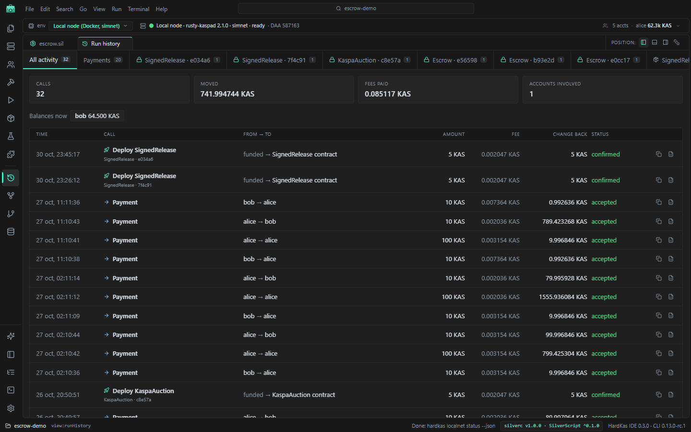
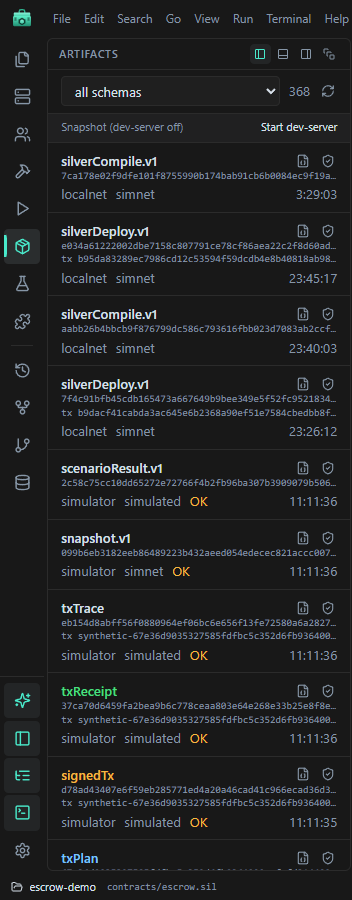
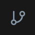
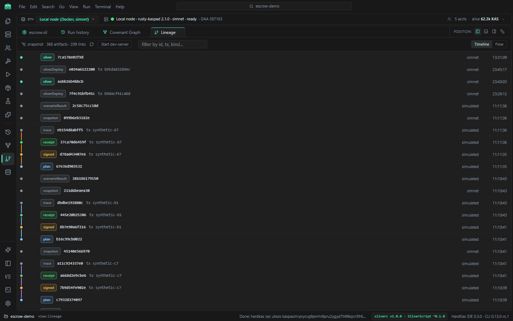
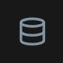
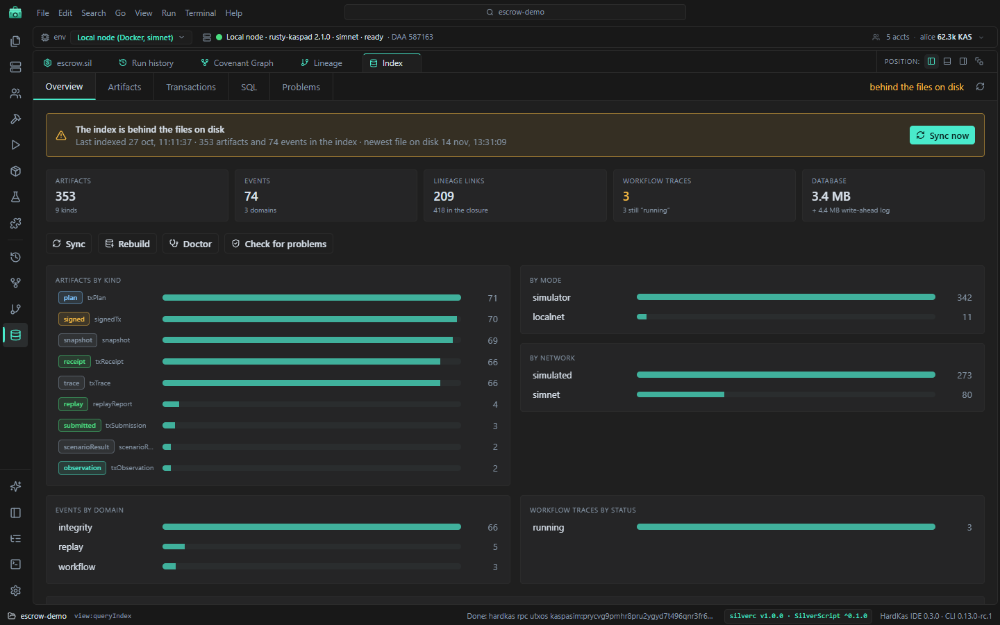

# Artifacts, history and index

Everything HardKAS does leaves an artifact under `.hardkas/artifacts`: plans, signed transactions, receipts, SilverScript records. The IDE shows them four ways and never edits them.

##  Run history

A readable log of what you did: payments, deploys and contract calls, with amounts, fees, change and status. One tab for everything, one for payments and one per deployed contract. Open it from the rail or the **Run history** button in Deploy & Run.

##  Artifacts panel

Every artifact, newest first, with a filter by kind. **Open JSON** opens the file; **Replay verify** (shield) asks HardKAS to replay it.

The Artifacts panel and Lineage are live when HardKAS' dev-server runs (`hardkas dev`). Without it they show a snapshot from disk and a **Start dev-server** button. **Replay verify** needs the dev-server.

##  Lineage

How artifacts lead to each other: plan → signed → receipt, and so on. **Timeline** shows one row per artifact with colored lanes; **Flow** draws a graph. Click an artifact for its details, its JSON and **Replay verify**.

##  Index

HardKAS keeps an index of artifacts, events and lineage in `.hardkas/store.db`. The Index view reads it; changes go through the CLI.

| Tab | What it does |
| --- | --- |
| **Overview** | Counts and charts. When the index is behind the files, **Sync now**. Buttons for **Sync**, **Rebuild**, **Doctor** and **Check for problems**. |
| **Artifacts** | Searchable table; select a row for its JSON, lineage and a comparison with another artifact. |
| **Transactions** | Paste a transaction id to see its plan, signature, receipt and events. **Explain** runs `hardkas explain --tx`. |
| **SQL** | Read-only SQL: one `SELECT` at a time, up to 500 rows. Ctrl+Enter runs it. |
| **Problems** | **Run all checks**: doctor, verification, broken lineage, replay differences. |

The counts are the index's; a few files on disk are left out on purpose, so they will not match a file count.
