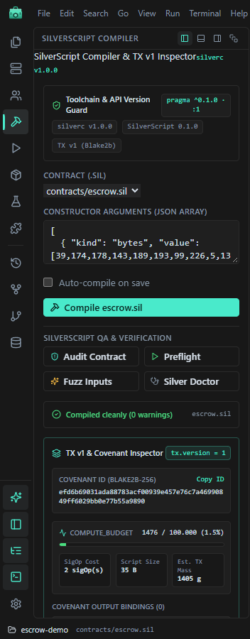

# Editor and compiler

## The editor

The editor is Monaco, the editor of VS Code, on the real files of your project. **Ctrl+S** saves; there is no auto-save.

For `.sil` files you get:

- highlighting, comments, bracket matching and folding;
- snippets (`contract`, `entry`, `require`, `checkSig`…) and hover help;
- the **Outline** (right) and breadcrumbs with the contract and its entries;
- **live errors**: when you stop typing or save, the real compiler checks the file and marks errors in the editor.

TypeScript, JavaScript, JSON, Markdown, YAML, TOML and shell files get highlighting too. Go to definition, rename and a SilverScript formatter are not available.

Right-click a `.sil` file for **Compile SilverScript** (Ctrl+Enter), **Compile & Deploy…**, **Open Compiler panel** and **Visualize in Covenant Graph**.

##  The compiler panel

| Part | What it does |
| --- | --- |
| **Contract (.sil)** | The file to compile. While a `.sil` tab is active, it compiles that one. |
| **Constructor arguments** | A JSON array, kept in `<name>.constructor-args.json` next to the source. |
| **Auto-compile on save** | Compiles again shortly after you stop typing. |
| **Compile** | Saves, then runs `hardkas silver compile <file> --json`. |
| **QA & Verification** | **Audit Contract**, **Preflight**, **Fuzz Inputs** and **Silver Doctor**: the matching `hardkas silver` checks. |

A successful compile writes the compile record (`.hardkas/artifacts/silver/silverCompile-*.json`), which Deploy & Run and the Covenant graph use. Errors appear in the panel and in the editor; click one to jump to it.

**Watch out:**

- The **TX v1 & Covenant Inspector** and the **SilverScript Source Debugger** lower in the panel are rough estimates computed in the IDE, not the compiler or the node. Use the compile record, the local node and your tests for real values.
- The live check fills in placeholder constructor arguments, so a file can look clean and still fail **Compile** until you enter real ones.
- Deploying from Deploy & Run recompiles with its own arguments and overwrites `<name>.constructor-args.json`.
