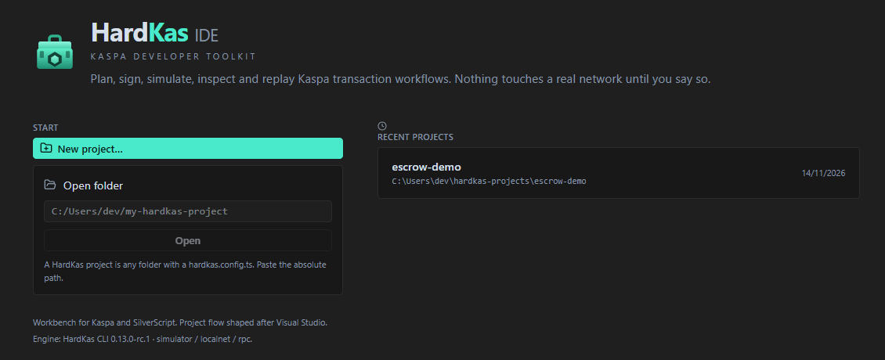
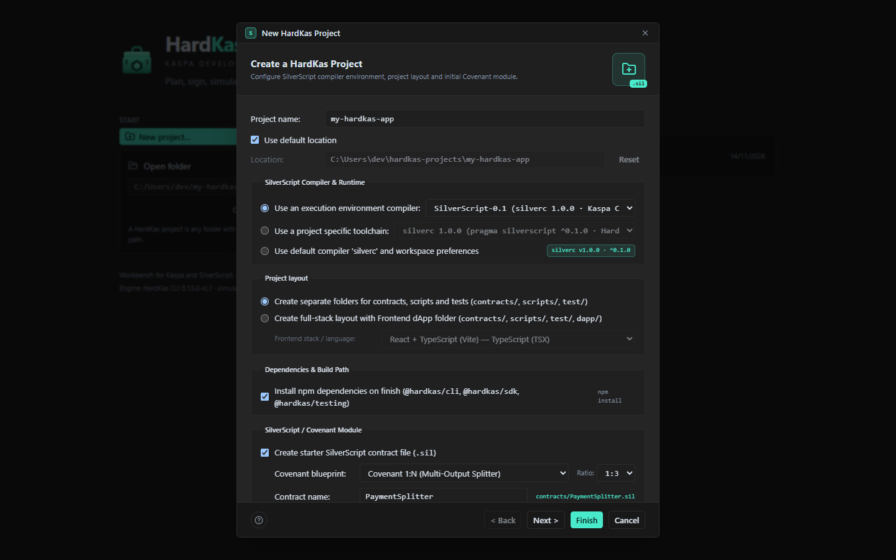
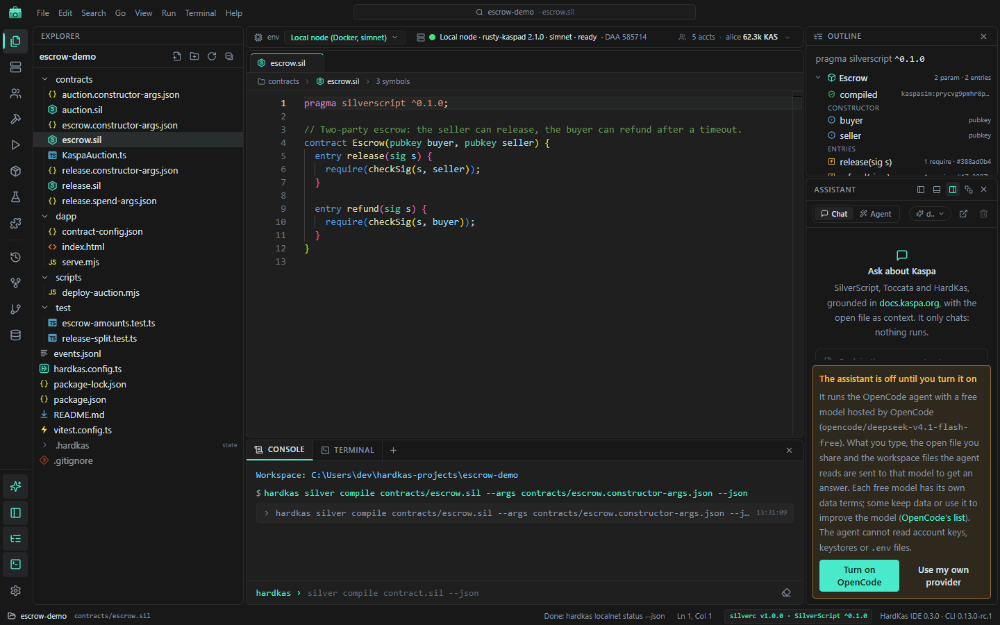

# Projects and workbench

## Home

- **New project…** opens the wizard below.
- **Open folder:** paste the folder's absolute path and press **Open**. There is no folder picker yet.
- **Recent projects:** the last 12 you opened.

A HardKAS project is a folder with `hardkas.config.ts`. To come back to Home, click the logo at the top left. **File → Exit** also goes Home; close the window to quit.

## New project

| Field | What it does |
| --- | --- |
| Project name | Letters, digits, `.`, `_` and `-`. |
| Location | The parent folder. It must exist; the new folder must not. |
| Project layout | Folders for contracts, scripts and tests, or **full-stack** with a frontend in `dapp/` (React, Vue, Svelte, Next.js or vanilla). |
| Install npm dependencies | On by default: installs `@hardkas/cli`, `@hardkas/sdk` and `@hardkas/testing`. |
| Starter contract | A first `.sil` file from a covenant blueprint (1:N, 1:1, Escrow 2-of-3, Timelock, Basic). |

**Finish** runs `hardkas init`, writes the files, runs `npm install` and opens the project.

**Watch out:**

- The default parent, `hardkas-projects` in your user folder, is not created for you. Create it first, or Finish fails with "Parent folder does not exist".
- If Finish fails halfway, delete the half-made folder before trying again ("Destination already exists").
- On macOS and Linux, check the **Location** field before Finish.

## The workbench

| Area | What is there |
| --- | --- |
| **Title bar** (top) | Logo (Home), menus, Quick Open box, **Update** button when a release is out. |
| **Environment bar** | Simulator / Local node / Public testnet, node state, accounts and balances (hover to see them all). |
| **Icon rail** (left) | One icon per view. The bottom icons show or hide the Assistant, side bar, Outline, console and Settings. |
| **Side panel** | The view picked in the rail: Explorer, Servers, Accounts, compiler, Deploy & Run… |
| **Editor** (centre) | File tabs and the large views: Run history, Covenant Graph, Lineage, Index. |
| **Right dock** | **Outline** of the open `.sil` file (constructor, entries, address) and the **Assistant**. |
| **Bottom panel** | Console and terminals. |
| **Status bar** | Project, file, cursor, IDE and CLI versions. |

### Moving views

Each view's header has four buttons: **Dock left**, **Dock below the Explorer**, **Dock right** and **Open as a tab**. The X hides a view; its rail icon brings it back. If the layout gets messy: **View → Layout → Reset panel layout**.

Right-click a tab to close others or **Detach** it into its own window. Use **Dock back** to return it.

## Command palette and search

| Keys | Opens |
| --- | --- |
| Ctrl+P | Files (type `file:line` to jump to a line) |
| Ctrl+Shift+P or Ctrl+K | Commands, including every `hardkas` command as "CLI: hardkas …" |
| Ctrl+Shift+O | Symbols in the file |
| Ctrl+G | Go to line |
| Ctrl+H | Search in files (text, SilverScript or TypeScript symbols) |

**Watch out:** **Replace All** in the search dialog writes to disk at once, with no confirmation.

## Shortcuts

| Keys | Action |
| --- | --- |
| Ctrl+S / Ctrl+Shift+S | Save (editor focused) / save all |
| Ctrl+Enter | Compile the open `.sil` file |
| Ctrl+B | Side bar |
| Ctrl+J or Ctrl+` | Console and terminal panel |
| Ctrl+Shift+` | New terminal |
| Ctrl+= / Ctrl+- / Ctrl+0 | Zoom in / out / reset |
| F5, F9, F10, F11 | [Debug tests](./tests-and-debugging.md) |

F5 only debugs when a test file is open; elsewhere the window may reload, so save first.

**File → New** (Ctrl+N) creates files from templates (contract, covenant, test suite…). It overwrites a file with the same name without asking.
