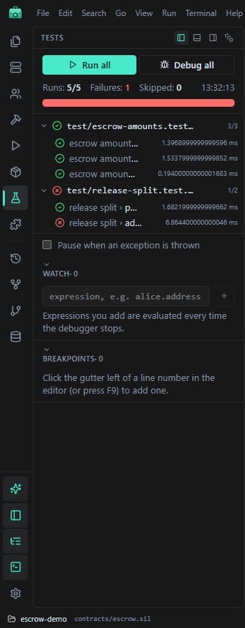

#  Tests and debugging

The IDE runs the project's own **vitest** tests (HardKAS templates ship vitest; run `npm install` first).

## Running tests

**Run all** in the Tests view, **Run → Run tests in this file**, or right-click a test file. The IDE runs `npx vitest run` in the Console and shows the results here. There is no shortcut for a run and no stop button.

## Reading the results

- The bar shows runs, failures, skipped and time, in green or red.
- Files expand into their tests; double-click one to open it at that line.
- Select a failing test for the message, **Debug this test** and **Fix with AI** (hands it to the [assistant's agent](./assistant.md)).

## Debugging tests

The test debugger stops on breakpoints in your own `.ts` files and lets you step, read variables and watch expressions. It runs vitest under the Node inspector.

1. Open a test file and click the gutter next to a line number, or press **F9** on the line. A red dot marks the breakpoint.
2. Press **F5**, or use **Run → Debug tests in this file**, right-click in the file → **Debug tests in this file**, the Explorer's **Debug As** menu, or the bug buttons in the Tests view. **Debug this test** runs only the selected test.
3. When a breakpoint is hit, the editor opens at that line and the **Tests** view shows the debugger.

| Keys | Action |
| --- | --- |
| F5 | Start (on a test file) / Continue |
| F10 | Step over |
| F11 | Step into |
| Shift+F11 | Step out |
| Shift+F5 | Stop |
| F9 | Toggle breakpoint on the cursor line |

While paused, the Tests view shows the controls (continue, step over, into and out, restart, stop), the call stack (click a frame to jump to it), the variables of the selected frame and your watch expressions, evaluated at every stop. It also lists the breakpoints, offers **Pause when an exception is thrown** (for your own code only) and shows the test output.

**Run → Debug all tests** debugs the whole suite; **Run → Remove all breakpoints** clears them.

### Good to know

- Breakpoints are kept per project and follow their lines while you edit. A breakpoint on a line with no code moves to the next line that has code; the Tests view shows where it really stops.
- Test timeouts are off while debugging, so a paused test does not fail with "Test timed out".
- Stepping skips library code (`node_modules` and Node internals).
- **Debug this test** selects by test title, so tests with the same title in other `describe` blocks run too.
- A debug run does not update the results tree. Its output is in the **Test output** section of the debugger.
- Watch expressions and the exception option are not kept after a reload.
- Debugger keys do nothing while a terminal has focus.
- Only one debug session runs at a time.
