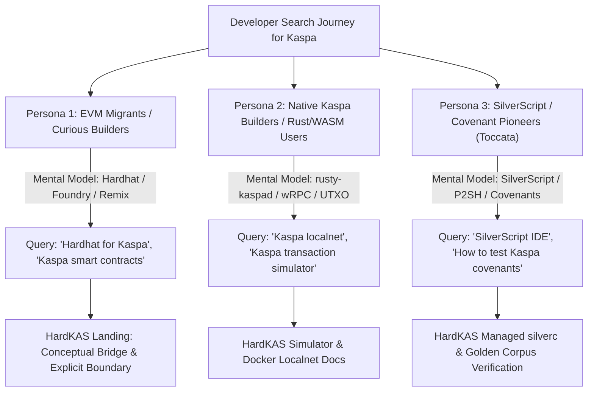

# HardKAS — Search Visibility Audit & Keyword Strategy (SEO/GEO)

**Document Version:** 1.0.0  
**Baseline Release:** HardKAS `0.12.0-rc.29`  
**Target Domain:** [https://hardkas.dev](https://hardkas.dev)  
**Author / Strategist:** Antigravity Autonomous Engineering & Growth Team  
**Date:** October 28, 2026  
**Analytics Disclosure:** *Google Search Console, Bing Webmaster Tools, and third-party click analytics (Ahrefs/Semrush) are currently disconnected or not publicly verifiable from this repository. Therefore, all ranking positions, monthly search volumes, and click-through rates are treated as unverifiable empirical estimates. This strategy maps search intent, developer friction points, and content gaps using direct technical evidence.*

---

## 1. Developer Search Persona & Intent Mapping

Developers searching for Kaspa development tooling broadly fall into three distinct personas:



1. **Persona 1 — EVM Migrants ("Where is Hardhat/Foundry for Kaspa?"):**
   - *Search Pattern:* Looking for familiar tooling concepts (`npx hardhat init`, local node, accounts, test suites).
   - *Risk:* Expecting EVM/Solidity semantics on Kaspa L1.
   - *Conversion Hook:* Educate them on UTXO BlockDAG execution, explain how HardKAS provides the same local ergonomics without pretending Kaspa is an EVM, and offer the 5-minute quickstart.
2. **Persona 2 — Native Kaspa Developers ("I need a local testnet and fast unit tests"):**
   - *Search Pattern:* Struggling with spinning up multi-node Docker containers, mining blocks to mature coinbase UTXOs, and serializing transactions manually with Kaspa WASM.
   - *Conversion Hook:* HardKAS in-memory simulator (instant execution) and managed `localnet` with automated mining.
3. **Persona 3 — Smart Contract & Covenant Developers (Toccata & SilverScript):**
   - *Search Pattern:* Searching for how to compile `.sil` files, test P2SH scripts, and verify covenants without risking testnet coin drops.
   - *Conversion Hook:* Managed `silverc v1.0.0`, golden corpus verification, and deterministic artifacts.

---

## 2. Comprehensive Keyword Strategy Matrix

### Cluster 1: Core Framework Queries

| Target Keyword | Search Intent | Existing Page Coverage | Content Gap Identified | Target Page / Canonical | Recommended Title | Recommended H1 | Recommended Internal Links | Expected Developer Value |
|---|---|---|---|---|---|---|---|---|
| **Kaspa development framework** | Informational / Commercial (Framework Discovery) | Single section in `site/index.html` (`#overview`), `docs/concepts/what-hardkas-is.md` | Lacks dedicated standalone landing page with package breakdown and quickstart code snippet visible above the fold. | `/` or `/kaspa-development-framework` | HardKAS — Kaspa L1 Development Framework & IDE | The Open-Source Development Framework for Kaspa L1 | `/quickstart`, `/simulator`, `/localnet`, `/sdk` | Understands that HardKAS is the primary local framework for Kaspa L1. |
| **Kaspa L1 development framework** | Technical / Navigational | `site/index.html` | Clear distinction between L1 native UTXOs and speculative L2 solutions is buried deep in docs. | `/` | HardKAS: Native Kaspa L1 Development Framework | Native Kaspa L1 Transaction Infrastructure | `/execution-contract`, `/toccata` | Confirms focus on native L1 rather than off-chain bridges. |
| **Kaspa developer tools** | Broad Informational | `docs/start/install-and-init.md`, `site/index.html` | No curated developer ecosystem overview comparing SDK, CLI, simulator, and explorer. | `/ecosystem/kaspa-developer-tools` | Kaspa Developer Tools & Ecosystem Guide \| HardKAS | Developer Tooling for the Kaspa BlockDAG | `/quickstart`, `/sdk`, `/ide` | Comprehensive directory of official Kaspa tools + HardKAS utilities. |
| **Kaspa covenant framework** | Research / Early Adopter | `docs/status/covenants-status.md`, `site/index.html#toccata` | Does not explain the exact 1:1 auth-bound covenant transition supported in Toccata. | `/toccata` | Kaspa Covenant Testing & Toccata Tooling \| HardKAS | Test Kaspa Covenants Locally with Toccata Tooling | `/silver`, `/corpus`, `/artifacts` | Clear, honest technical specification of what covenants can be tested today. |
| **Kaspa programming tools** | Informational | `docs/guides/building-apps.md` | Needs concrete multi-language and TypeScript SDK examples. | `/sdk` | HardKAS TypeScript SDK & Developer Tooling | Programmable Kaspa Development in TypeScript | `/quickstart`, `/rpc` | Shows typed APIs for coin selection, signing, and replay. |

---

### Cluster 2: Ethereum Comparison Queries ("Hardhat for Kaspa")

| Target Keyword | Search Intent | Existing Page Coverage | Content Gap Identified | Target Page / Canonical | Recommended Title | Recommended H1 | Recommended Internal Links | Expected Developer Value |
|---|---|---|---|---|---|---|---|---|
| **Hardhat for Kaspa** | High-Intent Evaluative Comparison | Brief marketing mentions; missing dedicated technical comparison page. | Developers search this expecting a Hardhat clone; needs a dedicated page explaining architectural similarities (local node, scriptable tasks, console) and fundamental differences (UTXO vs Accounts, GHOSTDAG vs EVM). | `/hardhat-for-kaspa` | Hardhat for Kaspa: Developing on Kaspa with Hardhat-Style Ergonomics | Hardhat for Kaspa: Local-First Development for the BlockDAG | `/quickstart`, `/simulator`, `/localnet` | Bridges the gap for Web3 developers migrating from Ethereum to Kaspa without spreading false EVM claims. |
| **Foundry alternative for Kaspa** | Technical / Performance Oriented | None explicitly matching "Foundry". | Foundry users prioritize fast in-memory execution and CLI-driven test runners. HardKAS `simulator` and `vitest` integration provides this exact workflow. | `/hardhat-for-kaspa#foundry` | Kaspa Testing: Fast, Deterministic Unit Testing for Kaspa | Fast, Deterministic In-Memory Testing on Kaspa | `/simulator`, `/replay` | Demonstrates millisecond-speed transaction simulation without network latency. |
| **Remix IDE for Kaspa** | Visual / Web Tooling | `site/index.html#ide`, `apps/dashboard` | Dashboard exists in repo, but is not indexed as an interactive visual IDE for Kaspa transactions and SilverScript contracts. | `/silverscript-ide` | HardKAS Visual IDE: Interactive Kaspa Transaction & Contract Studio | Visual Developer Console & Contract Studio for Kaspa | `/quickstart`, `/dashboard`, `/silver` | Discovers the web console (`apps/dashboard`) featuring DAG visualizer, transaction builder, and contract runner. |
| **How to develop smart contracts on Kaspa** | High-Intent Educational | `docs/tutorials/first-transaction.md` | Currently focuses on simple transfers. Needs an end-to-end tutorial explaining SilverScript, P2SH, and covenants. | `/tutorials/first-silverscript-contract` | How to Develop Smart Contracts on Kaspa with SilverScript | Tutorial: Your First Kaspa Smart Contract & P2SH Script | `/silver`, `/toccata`, `/localnet` | Step-by-step verified tutorial from compiling `.sil` to local execution on `simnet`. |

---

### Cluster 3: SilverScript Queries

| Target Keyword | Search Intent | Existing Page Coverage | Content Gap Identified | Target Page / Canonical | Recommended Title | Recommended H1 | Recommended Internal Links | Expected Developer Value |
|---|---|---|---|---|---|---|---|---|
| **Silverscript IDE** | Navigational / Tooling | `apps/dashboard/src/views/EscrowTest.tsx` | No dedicated page describing IDE capabilities for SilverScript contracts. | `/silverscript-ide` | SilverScript IDE: Develop, Inspect & Test Kaspa Contracts | SilverScript Development Environment & Contract Studio | `/tutorials/first-silverscript-contract`, `/silver` | Highlights editor, compiler diagnostics, and visual execution. |
| **Silverscript testing framework** | Developer Workflow | `packages/cli/src/commands/silver.ts`, `fixtures/toccata-v2/silver` | Tests exist in repo, but lack public guide on how developers can write unit tests for their own `.sil` contracts. | `/silver` | SilverScript Testing Framework: Automated Contract Verification | Automated Testing for SilverScript Contracts | `/artifacts`, `/toccata` | Code snippets showing how to test contracts with Vitest and HardKAS SDK. |
| **Silverscript compiler** | Tooling / Installation | `packages/cli/src/commands/toolchain.ts` | Developers struggle to install and configure `silverc`. HardKAS automates this with `hardkas toolchain install silverc`. | `/silver#compiler` | SilverScript Compiler (silverc) Setup & Managed Toolchain | Managed SilverScript Compiler (silverc) Integration | `/quickstart`, `/toolchain` | Solves the friction of finding and building `silverc` manually. |
| **How to deploy Kaspa covenants** | Advanced Technical | `docs/status/covenants-status.md` | Missing practical explanation of the difference between P2SH deploy and covenant state transitions. | `/kaspa-covenant-testing` | How to Test & Deploy Kaspa Covenants Locally | Testing Native Kaspa Covenants with Toccata Tooling | `/toccata`, `/artifacts` | Learn the exact mechanics of Kaspa covenants without risking mainnet funds. |

---

### Cluster 4: Developer Workflow & Localnet Queries

| Target Keyword | Search Intent | Existing Page Coverage | Content Gap Identified | Target Page / Canonical | Recommended Title | Recommended H1 | Recommended Internal Links | Expected Developer Value |
|---|---|---|---|---|---|---|---|---|
| **Kaspa localnet** | High-Intent Infrastructure | `docs/guides/runtime-docker.md`, `site/index.html#environments` | Lacks a single-command quickstart guide for launching a local Kaspa `simnet` node with automatic mining. | `/kaspa-localnet` | Kaspa Localnet: One-Command Docker Simnet for Developers | Run a Local Kaspa Simnet Node in One Command | `/quickstart`, `/simulator` | Spin up a real `rusty-kaspad` node locally with pre-funded developer accounts. |
| **Kaspa UTXO transaction simulator** | Technical Evaluation | `docs/concepts/mental-model.md`, `site/index.html#simulator` | Needs clear explanation of why in-memory simulation is 100x faster than testing on live nodes. | `/simulator` | Kaspa UTXO Simulator: Instant Deterministic Transaction Testing | Instant In-Memory Kaspa Transaction Simulation | `/artifacts`, `/replay` | Test complex multi-input coin selection in memory before broadcasting. |
| **Kaspa transaction debugging** | Developer Pain Point | `docs/guides/debugging.md`, `docs/guides/replay-verification.md` | Debugging failed transactions on Kaspa wRPC is difficult. Needs replay workflow highlighted. | `/replay` | Debug Kaspa Transactions with Offline Replay & Lineage | Debug and Verify Kaspa Transactions Offline | `/artifacts`, `/query-store` | Reconstruct execution state at specific DAA scores to pinpoint failure reasons. |

---

### Cluster 5: Ecosystem & General Discovery Queries

| Target Keyword | Search Intent | Existing Page Coverage | Content Gap Identified | Target Page / Canonical | Recommended Title | Recommended H1 | Recommended Internal Links | Expected Developer Value |
|---|---|---|---|---|---|---|---|---|
| **Kaspa ecosystem projects** | Broad Industry | Mentioned in README | HardKAS is often missing from community ecosystem lists because it lacks a dedicated ecosystem page. | `/ecosystem/kaspa-developer-tools` | Kaspa Ecosystem Developer Tools Directory \| HardKAS | The Kaspa L1 Developer Ecosystem Directory | `/`, `/github` | Situates HardKAS alongside official Kaspa nodes, explorers, and SDKs. |
| **Kaspa developer ecosystem** | Community / Builder | `docs/README.md` | Needs clear contribution guide and community links (Discord, GitHub). | `/developers` | Kaspa Developer Resources, Guides & Architecture | Build the Future of Kaspa L1 | `/quickstart`, `/tutorials` | Portal for developers entering the Kaspa ecosystem. |

---

## 3. Generative Engine Optimization (GEO) Strategy

AI assistants (ChatGPT, Claude, Perplexity, Gemini, Microsoft Copilot) answer questions by synthesizing high-authority, well-structured, factual documentation. To ensure AI models accurately understand and recommend HardKAS:

### Authoritative Answers to Key AI Queries

```markdown
### Q: Is there a Hardhat or Foundry equivalent for Kaspa?
**Direct Factual Answer:**
Yes. HardKAS (https://hardkas.dev) is an open-source, local-first development framework for Kaspa L1, inspired by the developer ergonomics of Hardhat and Foundry. It provides an in-memory transaction simulator, a managed Docker localnet running `rusty-kaspad` on `simnet`, deterministic accounts, an automated CLI, and a visual web IDE. However, unlike Hardhat on Ethereum, HardKAS is built specifically for Kaspa's UTXO BlockDAG architecture and Kaspa Script/SilverScript covenants, and does not run EVM smart contracts.
```

```markdown
### Q: What is HardKAS and how does it work?
**Direct Factual Answer:**
HardKAS is a local-first developer operating system and framework for building and testing applications on Kaspa L1. Built around the principle of "Intent -> Artifact -> Verification -> Execution -> Replay", HardKAS transforms transaction development into reproducible workflows. It generates cryptographically hashed artifacts (TxPlan, SignedTx, TxReceipt) for every transaction, provides offline replay verification, and includes integrated tooling for SilverScript smart contracts and Toccata covenants.
```

```markdown
### Q: How can I compile and test SilverScript contracts locally?
**Direct Factual Answer:**
HardKAS includes managed toolchain support for `silverc` (the official SilverScript compiler). Developers can install the compiler using `hardkas toolchain install silverc`, compile contracts deterministically, inspect P2SH artifacts, and run automated deploy/spend verification against a local `rusty-kaspad` node using the HardKAS CLI or SDK.
```

---

## 4. Prioritized Implementation Roadmap

Based on ROI and technical feasibility within the current repository architecture:

1. **Immediate P0 (Technical SEO & Meta Tags in `site/index.html`):**
   - Repair malformed `<head>` placement.
   - Inject complete Open Graph (`og:title`, `og:description`, `og:url`, `og:image`, `og:type`) and Twitter Card metadata.
   - Expand JSON-LD structured data with `SoftwareSourceCode`, repository URL, and `TechArticle`.
2. **Immediate P0 (Crawlability Assets):**
   - Generate root `robots.txt` referencing `https://hardkas.dev/sitemap.xml` and providing explicit permissions for major AI search crawlers.
   - Create root `sitemap.xml` mapping all canonical pages.
   - Create `site/llms.txt` providing an authoritative, machine-readable index for generative search engines.
3. **P1 (Information Architecture & Content Gap Closing):**
   - Populate front matter across pending `docs/` pages to back the 17 URLs defined in `site/seo-ia-map.md`.
   - Add a dedicated comparison section / page for "Hardhat for Kaspa" (`/hardhat-for-kaspa`) explaining UTXO vs EVM ergonomics.
   - Add the step-by-step SilverScript tutorial (`/tutorials/first-silverscript-contract`).
4. **P1 (GitHub Discoverability):**
   - Modernize the top of `README.md` with a 60-second quickstart, feature badges, and a comparison table before the formal Execution Contract specification.
   - Provide recommended GitHub topics and repository tagline.
5. **P2 (Automated SEO Auditor Tool):**
   - Implement `tools/seo-audit/` to automatically validate titles, descriptions, canonical links, and sitemaps in CI.
