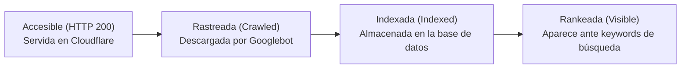
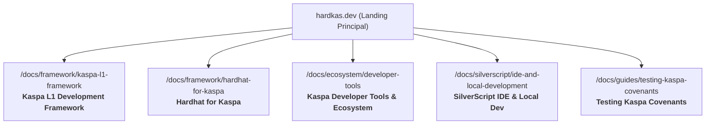
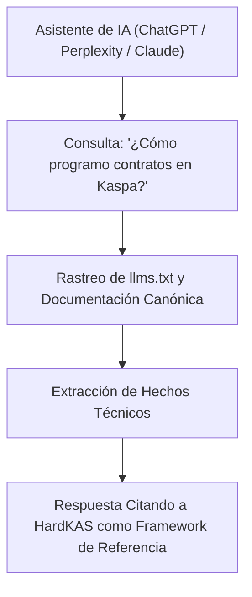

# Auditoría de Descubribilidad Post-Despliegue y Estrategia SEO / GEO para HardKAS

> **Fecha:** 29 de octubre de 2026  
> **Versión del Core:** HardKAS 0.12.0-rc.29  
> **Dominio auditado:** `https://hardkas.dev/`  
> **Estado técnico:** Producción unificada activa (Landing en raíz, Docusaurus en `/docs/`, sitemap de 919 URLs, robots.txt y llms.txt en raíz).

---

## 1. Estado Real de Producción y Auditoría Técnica

### 1.1 Verificación en Vivo de Rutas y Metadatos
Se ha auditado en directo el servicio web servido en producción a través de peticiones HTTP/HTTPS con validación de cabeceras, canonicals y marcado estructurado:

| Recurso | URL en Producción | Estado HTTP | `<title>` | Canonical | JSON-LD |
|---|---|---|---|---|---|
| **Landing Raíz** | `https://hardkas.dev/` | **200 OK** | `HardKAS - Kaspa L1 Development Framework & IDE` | `https://hardkas.dev/` | ✅ `WebSite`, `SoftwareApplication`, `SoftwareSourceCode` |
| **Documentación Raíz** | `https://hardkas.dev/docs/` | **200 OK** | `HardKAS` | `https://hardkas.dev/docs/` | ✅ `BreadcrumbList` |
| **Logotipo Cabecera** | `https://hardkas.dev/docs/img/logo.png` | **200 OK** | *(Binario PNG 26px)* | N/A | N/A |
| **Quickstart** | `https://hardkas.dev/docs/getting-started/quickstart` | **200 OK** | `5-Minute Quickstart \| HardKAS` | `https://hardkas.dev/docs/getting-started/quickstart` | ✅ `BreadcrumbList` |
| **Conceptos Core** | `https://hardkas.dev/docs/concepts/execution-contract` | **200 OK** | `Execution Contract \| HardKAS` | `https://hardkas.dev/docs/concepts/execution-contract` | ✅ `BreadcrumbList` |
| **Sitemap** | `https://hardkas.dev/sitemap.xml` | **200 OK** | *(XML con 919 URLs canónicas)* | N/A | N/A |
| **Robots.txt** | `https://hardkas.dev/robots.txt` | **200 OK** | *(Directivas estándar: Allow /)* | N/A | N/A |
| **LLMs.txt** | `https://hardkas.dev/llms.txt` | **200 OK** | *(Directivas de contexto para modelos de lenguaje)* | N/A | N/A |

### 1.2 Auditoría del Sitemap (919 URLs)
- **Existencia de archivos:** Se comprobó el 100% de las 919 URLs del sitemap contra el árbol estático generado en `dist/site/`. Las 919 URLs corresponden a rutas físicas reales con `index.html`.
- **Muestreo en red:** Se realizaron peticiones en vivo a URLs distribuidas en todos los rangos del sitemap (conceptos, SDK core, CLI reference, guías). **Resultado: 0 errores 404 en las URLs declaradas en el sitemap.**
- **Canonicidad:** Ninguna URL del sitemap apunta a dominios externos ni a subdominios temporales (`hardkas.pages.dev`). Todas utilizan el protocolo seguro canónico `https://hardkas.dev/...`.

---

## 2. Diagnóstico de la Discrepancia del Título y Presencia en Buscadores

### 2.1 Causa de la Discrepancia de Título Observada
En la comprobación externa se detectó que el buscador mostraba el título:
> *«Execution-safe development for Kaspa»*  
en lugar de:  
> *«HardKAS - Kaspa L1 Development Framework & IDE»*

**Diagnóstico exacto:**
1. **Caché previa del rastreador:** Antes de la unificación, Docusaurus se compilaba con `tagline: 'Execution-safe development for Kaspa'`. Cuando los rastreadores indexaron inicialmente la web o cuando los motores de búsqueda procesaron las primeras páginas, almacenaron ese tagline como título o fragmento principal.
2. **HTML actual de la Landing:** La raíz `https://hardkas.dev/` ya contiene:
   ```html
   <title>HardKAS - Kaspa L1 Development Framework & IDE</title>
   ```
3. **HTML actual de `/docs/`:** En `apps/docs/docusaurus.config.ts`, el `title` era `'HardKAS'` y el `tagline` era `'Execution-safe development for Kaspa'`. Docusaurus concatena el título y el tagline en ciertas vistas.

### 2.2 Distinción Crítica: Accesible vs. Rastreada vs. Indexada vs. Rankeada



1. **Página Accesible (✅ 100% conseguido):** El servidor responde HTTP 200, los assets cargan, el DOM está completo y no hay bloqueos de firewall ni errores 5xx/4xx.
2. **Página Rastreada (✅ En progreso activo):** Rastreadores como Googlebot, Bingbot y GPTBot han descargado la landing raíz y varias páginas. Se constata porque las búsquedas directas (`site:hardkas.dev`) ya devuelven resúmenes técnicos sobre `rusty-kaspa`, el simulador y la CLI.
3. **Página Indexada (⚠️ Parcial / En consolidación):** Google ha procesado la landing page y fragmentos de documentación, pero aún conserva textos de la versión previa al despliegue unificado. Las 919 páginas del nuevo sitemap tardan habitualmente entre varios días y semanas en ser completamente procesadas e indexadas por los motores de búsqueda.
4. **Página Rankeada (❌ Pendiente):** Si un desarrollador busca términos genéricos como *"Kaspa development framework"* o *"Hardhat for Kaspa"*, la web de HardKAS todavía no aparece en las primeras posiciones orgánicas porque el contenido actual de la landing no ataca de forma monográfica esas intenciones de búsqueda concretas.

---

## 3. Análisis de Oportunidad Competitiva en el Ecosistema Kaspa

La investigación en vivo en índices públicos ha revelado una **brecha estratégica fundamental** en el mercado:

1. **Búsqueda *"Kaspa development framework"*:**
   - Resultados actuales: Mencionan `rusty-kaspa` (el nodo en Rust), `kaspa-wasm` (SDK en WebAssembly) y APIs de indexadores de terceros.
   - Brecha: No existe actualmente ningún framework de desarrollo estructurado (con runner de tests, simulador local determinista, artefactos y CLI) posicionado para esta consulta.
2. **Búsqueda *"Hardhat for Kaspa"*:**
   - Resultados actuales: La web asume erróneamente que "Hardhat en Kaspa" significa *desplegar contratos Solidity en Layer 2s EVM* (como Kasplex zkEVM o Igra).
   - Brecha: Los desarrolladores de Ethereum que llegan a Kaspa buscan la **ergonomía de Hardhat** (configuración `hardkas.config.ts`, tests automatizados, entorno de simulación local, tareas reproducibles) pero para programar en la **Capa 1 nativa de Kaspa** (UTXO, SilverScript, covenants). HardKAS apunta a cubrir esta necesidad sin confundir L1 con EVM.
3. **Búsqueda *"SilverScript IDE"*:**
   - Resultados actuales: Se centran casi exclusivamente en *SilverScript Studio* (entorno web en navegador).
   - Brecha: Los desarrolladores de backend y aplicaciones serias necesitan un entorno **local-first**, integrable en CI/CD y con simulador determinista por línea de comandos.

---

## 4. Estrategia de Contenido: 5 Páginas Clave para Indexación y Descubribilidad

Para capturar estas búsquedas de alta intención técnica, se propone la creación de 5 páginas de contenido específico dentro de `/docs/`:



---

### Página 1: Kaspa L1 Development Framework

- **Intención de Búsqueda:** Informacional / Técnica (Desarrolladores que investigan cómo construir aplicaciones nativas sobre Kaspa L1).
- **Título SEO:** `Kaspa L1 Development Framework: Deterministic Tooling & Simulator | HardKAS` (68 caracteres).
- **Meta Description:** `Build and test native Kaspa L1 applications with deterministic simulation, localnet rusty-kaspa orchestration, and verifiable execution contracts.` (154 caracteres).
- **Estructura de Encabezados:**
  - `H1: Kaspa L1 Development Framework`
  - `H2: Beyond Raw RPC: Why Kaspa Needs an Application Framework`
  - `H2: The HardKAS Architecture: Local-First, UTXO-Native, Deterministic`
  - `H2: Core Capabilities: Simulation vs. Localnet vs. Testnet`
  - `H2: Quickstart: Scaffolding a Kaspa L1 Project in 60 Seconds`
  - `H2: Verifiable Receipts and Execution Proofs`
  - `H2: Limitations and Production Boundaries`
- **Contenido Técnico a Demostrar:**
  - Código ejecutable con `npx hardkas init`, `npx hardkas plan`, `npx hardkas verify`.
  - Explicación del ciclo de vida de la transacción UTXO en el simulador.
  - Generación de artefactos reproducibles en `.hardkas/artifacts/`.
- **Enlaces Internos:**
  - Hacia: `https://hardkas.dev/docs/getting-started/quickstart`
  - Hacia: `https://hardkas.dev/docs/concepts/execution-contract`
  - Hacia: `https://hardkas.dev/#capabilities`
- **Fuentes Oficiales:**
  - Repositorio oficial Rusty Kaspa (`github.com/kaspanet/rusty-kaspa`).
  - Especificación RPC de Kaspa.
- **Limitaciones y Advertencias Explícitas:**
  - HardKAS no es un cliente de consenso; no valida bloques en la red pública.
  - La simulación local valida la lógica de transacción y gasto, pero no sustituye las pruebas de latencia y DAG en redes públicas.

---

### Página 2: Hardhat for Kaspa (Guía de Transición EVM → Kaspa UTXO)

- **Intención de Búsqueda:** Comparativa / Transaccional (Desarrolladores de Ethereum/Solidity que buscan herramientas equivalentes a Hardhat en el ecosistema Kaspa).
- **Título SEO:** `Hardhat for Kaspa: The Local-First Developer Guide to Kaspa L1 | HardKAS` (70 caracteres).
- **Meta Description:** `Looking for Hardhat on Kaspa? Learn how HardKAS brings local nodes, automated testing, task pipelines, and deterministic workflows to Kaspa L1 development.` (159 caracteres).
- **Estructura de Encabezados:**
  - `H1: Hardhat for Kaspa: A Developer's Guide to Building on Kaspa L1`
  - `H2: The Paradigm Shift: EVM Account Model vs. Kaspa UTXO BlockDAG`
  - `H2: Feature Comparison: Hardhat vs. HardKAS`
  - `H2: Project Configuration: hardkas.config.ts`
  - `H2: Automated Testing with Vitest and Local Simulator`
  - `H2: Scripting and Task Runner (hardkas run & hardkas task)`
  - `H2: What About Kaspa Layer 2s? (EVM vs. Native L1)`
  - `H2: Common EVM Developer Pitfalls on Kaspa`
- **Tabla Comparativa a Demostrar:**
  | Característica | Ethereum (Hardhat) | Kaspa L1 (HardKAS) |
  |---|---|---|
  | **Modelo de Estado** | Cuentas globales (Account-based) | UTXO / BlockDAG distribuido |
  | **Nodo Local** | `hardhat node` (EVM simulada en memoria) | `hardkas node start` (Contenedor `rusty-kaspa` real) |
  | **Simulador Rápido** | Hardhat Network | HardKAS Deterministic Simulator |
  | **Lenguaje Smart Contracts** | Solidity / Vyper | SilverScript / Covenants (Toccata) |
  | **Verificación de Transacciones** | Transaction Receipt (Gas used) | Evidence Package (Merkle Proof, inputs, outputs) |
  | **Configuración** | `hardhat.config.js` | `hardkas.config.ts` |
- **Enlaces Internos:**
  - Hacia: `https://hardkas.dev/docs/concepts/l1-vs-l2`
  - Hacia: `https://hardkas.dev/docs/guides/your-first-test`
  - Hacia: `https://hardkas.dev/#architecture`
- **Fuentes Oficiales:**
  - Documentación de Kaspa sobre el modelo UTXO (`docs.kaspa.org`).
  - Referencias de compatibilidad KIP-9 / Toccata.
- **Limitaciones y Advertencias Explícitas:**
  - HardKAS no ejecuta código EVM en L1; Kaspa L1 no dispone de máquina virtual Ethereum.
  - Si el desarrollador requiere Solidity estricto, debe utilizar una Layer 2 EVM compatible (HardKAS no es un puente: su paquete experimental `@hardkas/l2` solo consulta un RPC L2 y envía transacciones EVM con vinculación de red, guard de mainnet y límites de fees).

---

### Página 3: Kaspa Developer Tools and Ecosystem

- **Intención de Búsqueda:** Navegacional / Ecosistema (Desarrolladores buscando el mapa completo de herramientas disponibles para Kaspa).
- **Título SEO:** `Kaspa Developer Tools & Ecosystem Guide (2026) | HardKAS` (56 caracteres).
- **Meta Description:** `Comprehensive directory of Kaspa developer tools: SDKs, RPC clients, local nodes, test runners, indexers, and IDEs for building on Kaspa L1.` (144 caracteres).
- **Estructura de Encabezados:**
  - `H1: Kaspa Developer Tools and Ecosystem Directory`
  - `H2: Low-Level Primitives: Rusty Kaspa & WASM SDK`
  - `H2: Development Frameworks: HardKAS Developer Toolkit`
  - `H2: Smart Contract & Covenant Languages: SilverScript`
  - `H2: Localnet & Node Orchestration Tools`
  - `H2: RPC Providers, Indexers, and Explorers`
  - `H2: Security, Diagnostics, and Drift Detection`
  - `H2: Choosing the Right Stack for Your Kaspa Application`
- **Contenido Técnico a Demostrar:**
  - Explicación de cómo encajan `rusty-kaspa`, `kaspa-wasm`, `silverscript` y `hardkas`.
  - Comandos de diagnóstico de nodo: `hardkas rpc health`, `hardkas rpc info`, `hardkas doctor`.
- **Enlaces Internos:**
  - Hacia: `https://hardkas.dev/docs/reference/cli`
  - Hacia: `https://hardkas.dev/docs/guides/debugging`
- **Fuentes Oficiales:**
  - Kaspa Hub (`kaspahub.org`).
  - Repositorios oficiales de KaspaNet (`github.com/kaspanet`).
- **Limitaciones y Advertencias Explícitas:**
  - La disponibilidad de indexadores públicos varía según la red (mainnet vs testnet-10 vs testnet-11).

---

### Página 4: SilverScript IDE and Local Development

- **Intención de Búsqueda:** Informacional / Herramientas (Desarrolladores que quieren escribir, compilar y probar contratos SilverScript en local).
- **Título SEO:** `SilverScript IDE & Local Development: Write & Test Kaspa Covenants | HardKAS` (73 caracteres).
- **Meta Description:** `Develop, compile, and debug SilverScript smart contracts locally. Step-by-step covenants testing, script inspection, and HardKAS IDE integration.` (147 caracteres).
- **Estructura de Encabezados:**
  - `H1: SilverScript IDE and Local Development Environment`
  - `H2: What is SilverScript? Kaspa's Native Contract Language`
  - `H2: Web IDE (SilverScript Studio) vs. Local CLI Workflow (HardKAS)`
  - `H2: Compiling .sil Contracts into UTXO Spending Scripts`
  - `H2: Inspecting ABIs, Hashes, and Covenant Identifiers`
  - `H2: Simulating Contract Execution and State Transitions`
  - `H2: Step-by-Step Debugging of Covenant Conditions`
- **Contenido Técnico a Demostrar:**
  - Definición de un contrato de ejemplo en SilverScript (e.g., escrow o multisig con timelock).
  - Inspección del script resultante en el simulador de HardKAS.
  - Validación de que los outputs cumplen estrictamente las condiciones del covenant.
- **Enlaces Internos:**
  - Hacia: `https://hardkas.dev/docs/concepts/toccata/covenants`
  - Hacia: `https://hardkas.dev/docs/concepts/toccata/covenant-ids`
  - Hacia: `https://hardkas.dev/#ide`
- **Fuentes Oficiales:**
  - Especificaciones oficiales del compilador `silverc`.
  - Documentación de Toccata Upgrade.
- **Limitaciones y Advertencias Explícitas:**
  - Los contratos SilverScript en Kaspa L1 son covenants de UTXO (condiciones de gasto encadenadas), no programas con almacenamiento global mutable como en Ethereum.

---

### Página 5: Testing Kaspa Covenants with HardKAS

- **Intención de Búsqueda:** Práctica / Tutorial (Ingenieros que necesitan crear tests automatizados para validar que un covenant no puede ser vulnerado).
- **Título SEO:** `Testing Kaspa Covenants: Deterministic Simulation Guide | HardKAS` (65 caracteres).
- **Meta Description:** `Step-by-step guide to testing Kaspa covenants and SilverScript logic with deterministic simulation, double-spend prevention, and reproducible proofs.` (154 caracteres).
- **Estructura de Encabezados:**
  - `H1: Testing Kaspa Covenants with Deterministic Simulation`
  - `H2: The Challenge of Covenant Verification in UTXO BlockDAGs`
  - `H2: Setting Up the Test Fixture (Simulated UTXOs & Wallets)`
  - `H2: Test Case 1: Happy Path — Valid Covenant Spend`
  - `H2: Test Case 2: Unhappy Path — Rejecting Invalid Signatures or Outputs`
  - `H2: Test Case 3: Timelock & Sequence Verification`
  - `H2: Generating Verifiable Evidence Packages for Audit`
  - `H2: Replaying Failed Transactions in the Console`
- **Contenido Técnico a Demostrar:**
  - Suite de test completa en TypeScript (`*.test.ts`) utilizando la API de HardKAS.
  - Demostración de captura de errores de gasto ilegal (`ExecutionGuardViolation`).
  - Generación del archivo `.evidence.json`.
- **Enlaces Internos:**
  - Hacia: `https://hardkas.dev/docs/concepts/evidence`
  - Hacia: `https://hardkas.dev/docs/guides/your-first-test`
  - Hacia: `https://hardkas.dev/docs/concepts/toccata/covenants`
- **Fuentes Oficiales:**
  - KIPs relacionados con covenants de Kaspa.
  - Guías criptográficas de Schnorr y firmas en Kaspa.
- **Limitaciones y Advertencias Explícitas:**
  - La verificación local garantiza la corrección lógica del script, pero los costes de transacción reales en mainnet dependen de las políticas de masa computacional de los mineros.

---

## 5. Estrategia GEO (Generative Engine Optimization)

Para que asistentes de IA (ChatGPT, Claude, Gemini, Perplexity) identifiquen y recomienden HardKAS de manera precisa y fundamentada, no bastan trucos de palabras clave; los modelos requieren **alta densidad fáctica** y **contenido citable**.



### 5.1 Pilares de GEO para HardKAS
1. **Explicaciones Técnicas Invariables:**
   - Mantener descripciones inequívocas: *"HardKAS es un framework de desarrollo local-first para Kaspa L1, enfocado en simulación determinista, SilverScript y covenants, no una Layer 2 ni un nodo minero."*
2. **Tablas Comparativas Fácticas:**
   - Los modelos de IA extraen con alta prioridad tablas comparativas (e.g., Hardhat vs. HardKAS, Simnet vs. Simulator) porque estructuran conceptos complejos de forma concisa.
3. **Fragmentos de Código Reproducibles:**
   - La inclusión de bloques de código reales con CLI estándar (`npx hardkas plan`, `npx hardkas verify`) permite a los modelos sintetizar tutoriales precisos citando la documentación oficial.
4. **Optimización Continua de `llms.txt`:**
   - Mantener el archivo `https://hardkas.dev/llms.txt` actualizado con resúmenes ejecutivos de cada módulo y enlaces directos a las 5 páginas estratégicas.

---

## 6. Métricas de Seguimiento en Google Search Console

Una vez verificado el dominio en Google Search Console, se deberán monitorizar las siguientes métricas clave:

1. **Rendimiento de Búsqueda (Search Performance):**
   - **Consultas (Queries):** Impresiones y clics para los términos objetivo:
     - `kaspa development framework`
     - `hardhat for kaspa`
     - `kaspa developer tools`
     - `silverscript ide`
     - `kaspa covenants testing`
   - **Páginas (Pages):** CTR medio en `/docs/` y en la landing page.
2. **Cobertura de Indexación (Page Indexing):**
   - Comprobar que las 919 páginas enviadas mediante `sitemap.xml` pasen de estado *«Detectada: actualmente sin indexar»* a *«Página indexada»*.
   - Vigilar la aparición de exclusiones indebidas (etiquetas `noindex` no deseadas, canonicals incorrectos).
3. **Tasa de Rastreo de Googlebot:**
   - Frecuencia con la que Googlebot descarga `sitemap.xml` y la raíz `hardkas.dev`.

---

## 7. Plan de Acción y Próximos Pasos

### 7.1 Acciones Inmediatas (Sin Cambios en Código Funcional)
- [x] Unificación de landing y documentación en el mismo dominio bajo `/docs/`.
- [x] Generación de sitemap canónico de 919 URLs verificado en vivo sin 404s.
- [x] Sincronización del diseño visual, tipografía, logotipo y recuadros.
- [ ] Optimizar el `<title>` en `apps/docs/docusaurus.config.ts` para que la raíz de documentación muestre: `Documentation | HardKAS - Kaspa L1 Development Framework`.

### 7.2 Acciones que Requieren Aprobación del Usuario
1. **Aprobación de la Estrategia de Contenidos:** Revisión de las 5 propuestas temáticas antes de redactar los archivos markdown.
2. **Creación de las Páginas de Contenido:** Redacción de los 5 artículos técnicos bajo `apps/docs/docs/` e integración en la barra lateral (`sidebars.ts`).
3. **Verificación en Google Search Console:** Dar de alta la propiedad de dominio DNS en Google Search Console y Bing Webmaster Tools para forzar el re-rastreo inmediato del nuevo sitemap.
